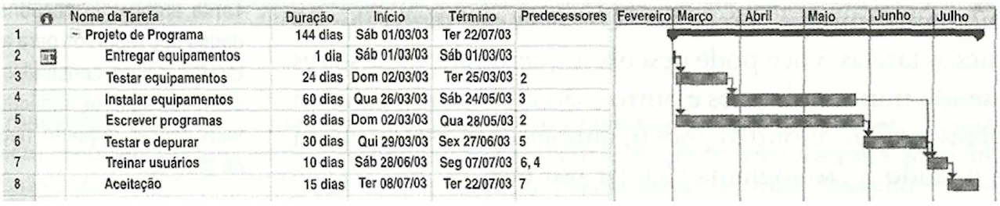
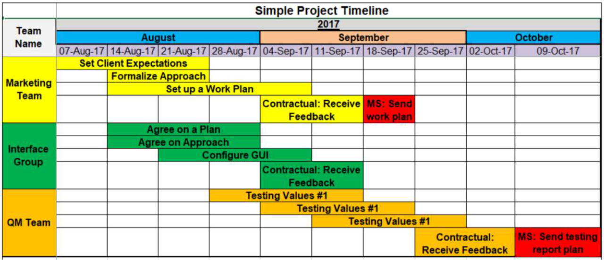

# Especificações do Projeto

Pré-requisitos: <a href="1-Documentação de Contexto.md"> Documentação de Contexto</a>

Definição do problema e ideia de solução a partir da perspectiva do usuário. É composta pela definição do  diagrama de personas, histórias de usuários, requisitos funcionais e não funcionais além das restrições do projeto.

Apresente uma visão geral do que será abordado nesta parte do documento, enumerando as técnicas e/ou ferramentas utilizadas para realizar a especificações do projeto

## Personas

| Característica | **Lucas Andrade** | **Mariana Souza** | **Rafael Oliveira** |
| :--- | :--- | :--- | :--- |
| **Perfil** | Estudante de Engenharia (22 anos) | Profissional de Marketing (29 anos) | Empreendedor (35 anos) |
| **Contexto** | República universitária (4 colegas) | Organização de viagens e eventos | Gestão familiar ampliada |
| **Principal Meio** | Pix e pagamentos imediatos | Cartão de crédito e parcelamentos | Visão macro e fluxo de caixa |
| **Dores** | Esquecimento e divisões desiguais | Cobranças chatas e parcelas longas | Desorganização e falta de visão global |
| **Comportamento** | Prático, odeia planilhas | Gosta de relatórios e organização | Analítico e focado em estratégia |
| **Objetivo** | Divisão automática e transparente | Saber quem, quanto e quando devem | Dashboard analítico e consolidado |
| **Necessidade** | Histórico rápido e saldo em tempo real | Gestão de saldo credor e lembretes | Controle global e eficiência de gastos |

> **Links Úteis**:
> - [Rock Content](https://rockcontent.com/blog/personas/)
> - [Hotmart](https://blog.hotmart.com/pt-br/como-criar-persona-negocio/)
> - [O que é persona?](https://resultadosdigitais.com.br/blog/persona-o-que-e/)
> - [Persona x Público-alvo](https://flammo.com.br/blog/persona-e-publico-alvo-qual-a-diferenca/)
> - [Mapa de Empatia](https://resultadosdigitais.com.br/blog/mapa-da-empatia/)
> - [Mapa de Stalkeholders](https://www.racecomunicacao.com.br/blog/como-fazer-o-mapeamento-de-stakeholders/)
>
Lembre-se que você deve ser enumerar e descrever precisamente e personalizada todos os clientes ideais que sua solução almeja.

## Histórias de Usuários

Com base na análise das personas forma identificadas as seguintes histórias de usuários:

| EU COMO | QUERO                             | PARA                             |
| ------- | --------------------------------- | -------------------------------- |
| Usuário | Criar um grupo de despesas        | Organizar contas compartilhadas  |
| Usuário | Convidar membros via link         | Facilitar entrada no grupo       |
| Usuário | Sair de um grupo                  | Não participar mais das despesas |
| Usuário | Registrar uma despesa             | Não esquecer gastos              |
| Usuário | Escolher tipo de divisão          | Garantir justiça                 |
| Usuário | Anexar comprovante                | Ter transparência                |
| Usuário | Parcelar despesa                  | Controlar pagamentos futuros     |
| Usuário | Visualizar saldo consolidado      | Saber quanto devo                |
| Usuário | Receber notificação de vencimento | Não atrasar pagamento            |
| Usuário | Gerar relatório mensal            | Controlar orçamento              |

| EU COMO       | QUERO                        | PARA                  |
| ------------- | ---------------------------- | --------------------- |
| Administrador | Alterar permissões           | Controlar organização |
| Administrador | Remover usuário inadimplente | Manter integridade    |

Apresente aqui as histórias de usuário que são relevantes para o projeto de sua solução. As Histórias de Usuário consistem em uma ferramenta poderosa para a compreensão e elicitação dos requisitos funcionais e não funcionais da sua aplicação. Se possível, agrupe as histórias de usuário por contexto, para facilitar consultas recorrentes à essa parte do documento.

> **Links Úteis**:
> - [Histórias de usuários com exemplos e template](https://www.atlassian.com/br/agile/project-management/user-stories)
> - [Como escrever boas histórias de usuário (User Stories)](https://medium.com/vertice/como-escrever-boas-users-stories-hist%C3%B3rias-de-usu%C3%A1rios-b29c75043fac)
> - [User Stories: requisitos que humanos entendem](https://www.luiztools.com.br/post/user-stories-descricao-de-requisitos-que-humanos-entendem/)
> - [Histórias de Usuários: mais exemplos](https://www.reqview.com/doc/user-stories-example.html)
> - [9 Common User Story Mistakes](https://airfocus.com/blog/user-story-mistakes/)

## Requisitos

As tabelas que se seguem apresentam os requisitos funcionais e não funcionais que detalham o escopo do projeto. Para determinar a prioridade de requisitos, aplicar uma técnica de priorização de requisitos e detalhar como a técnica foi aplicada.

<strong>Crie no mínimo 12 Requisitos funcionais, 6 não funcionais e 3 restrições</strong>
<strong>Cada aluno será responsável pela execução completa (back, web e mobile) de pelo menos 2 requisitos que será acompanhado pelo professor</strong>
### Requisitos Funcionais

| ID     | Descrição                         | Prioridade | Responsável |
| ------ | --------------------------------- | ---------- | ----------- |
| RF-001 | Cadastrar usuário                 | ALTA       | henrique    |
| RF-002 | Autenticação com JWT              | ALTA       | joao        |
| RF-003 | Criar grupo de despesas           | ALTA       | ana         |
| RF-004 | Convidar usuários via link        | ALTA       | fernanda    |
| RF-005 | Registrar despesa                 | ALTA       | wyvern      |
| RF-006 | Dividir despesa igualmente        | ALTA       | erick       |
| RF-007 | Dividir despesa proporcional      | ALTA       | francisco   |
| RF-008 | Parcelar despesa automaticamente  | MÉDIA      | leticia     |
| RF-009 | Gerar relatório mensal            | MÉDIA      | miguel      |
| RF-010 | Exibir dashboard consolidado      | ALTA       | amanda      |
| RF-011 | Enviar notificações de vencimento | MÉDIA      | sophia      |
| RF-012 | Anexar comprovante à despesa      | BAIXA      | sara        |
| RF-013 | Alterar permissões do grupo       | MÉDIA      | wendy       |
| RF-014 | Remover participante do grupo     | MÉDIA      | knupp       |

### Requisitos não Funcionais

| ID      | Descrição                            | Prioridade |
| ------- | ------------------------------------ | ---------- |
| RNF-001 | Sistema responsivo (Web + Mobile)    | ALTA       |
| RNF-002 | Tempo de resposta ≤ 2 segundos       | ALTA       |
| RNF-003 | Disponibilidade mínima de 99%        | MÉDIA      |
| RNF-004 | Criptografia de dados sensíveis      | ALTA       |
| RNF-005 | Backup automático diário             | MÉDIA      |
| RNF-006 | Suporte a 1.000 usuários simultâneos | MÉDIA      |
| RNF-007 | Sincronização em tempo real          | ALTA       |

Com base nas Histórias de Usuário, enumere os requisitos da sua solução. Classifique esses requisitos em dois grupos:

- [Requisitos Funcionais
 (RF)](https://pt.wikipedia.org/wiki/Requisito_funcional):
 correspondem a uma funcionalidade que deve estar presente na
  plataforma (ex: cadastro de usuário).
- [Requisitos Não Funcionais
  (RNF)](https://pt.wikipedia.org/wiki/Requisito_n%C3%A3o_funcional):
  correspondem a uma característica técnica, seja de usabilidade,
  desempenho, confiabilidade, segurança ou outro (ex: suporte a
  dispositivos iOS e Android).
Lembre-se que cada requisito deve corresponder à uma e somente uma
característica alvo da sua solução. Além disso, certifique-se de que
todos os aspectos capturados nas Histórias de Usuário foram cobertos.

## Restrições

| ID   | Restrição                         |
| ---- | --------------------------------- |
| R-01 | Entrega até final do semestre     |
| R-02 | Deve usar arquitetura distribuída |
| R-03 | Deve possuir versão web e mobile  |
| R-04 | Hospedagem obrigatória em nuvem   |

Enumere as restrições à sua solução. Lembre-se de que as restrições geralmente limitam a solução candidata.

> **Links Úteis**:
> - [O que são Requisitos Funcionais e Requisitos Não Funcionais?](https://codificar.com.br/requisitos-funcionais-nao-funcionais/)
> - [O que são requisitos funcionais e requisitos não funcionais?](https://analisederequisitos.com.br/requisitos-funcionais-e-requisitos-nao-funcionais-o-que-sao/)

## Diagrama de Casos de Uso

O diagrama de casos de uso é o próximo passo após a elicitação de requisitos, que utiliza um modelo gráfico e uma tabela com as descrições sucintas dos casos de uso e dos atores. Ele contempla a fronteira do sistema e o detalhamento dos requisitos funcionais com a indicação dos atores, casos de uso e seus relacionamentos. 

As referências abaixo irão auxiliá-lo na geração do artefato “Diagrama de Casos de Uso”.

> **Links Úteis**:
> - [Criando Casos de Uso](https://www.ibm.com/docs/pt-br/elm/6.0?topic=requirements-creating-use-cases)
> - [Como Criar Diagrama de Caso de Uso: Tutorial Passo a Passo](https://gitmind.com/pt/fazer-diagrama-de-caso-uso.html/)
> - [Lucidchart](https://www.lucidchart.com/)
> - [Astah](https://astah.net/)
> - [Diagrams](https://app.diagrams.net/)

# Gerenciamento de Projeto

De acordo com o PMBoK v6 as dez áreas que constituem os pilares para gerenciar projetos, e que caracterizam a multidisciplinaridade envolvida, são: Integração, Escopo, Cronograma (Tempo), Custos, Qualidade, Recursos, Comunicações, Riscos, Aquisições, Partes Interessadas. Para desenvolver projetos um profissional deve se preocupar em gerenciar todas essas dez áreas. Elas se complementam e se relacionam, de tal forma que não se deve apenas examinar uma área de forma estanque. É preciso considerar, por exemplo, que as áreas de Escopo, Cronograma e Custos estão muito relacionadas. Assim, se eu amplio o escopo de um projeto eu posso afetar seu cronograma e seus custos.

## Gerenciamento de Tempo

Com diagramas bem organizados que permitem gerenciar o tempo nos projetos, o gerente de projetos agenda e coordena tarefas dentro de um projeto para estimar o tempo necessário de conclusão.

)](img/02-diagrama-rede-simplificado.png)

O gráfico de Gantt ou diagrama de Gantt também é uma ferramenta visual utilizada para controlar e gerenciar o cronograma de atividades de um projeto. Com ele, é possível listar tudo que precisa ser feito para colocar o projeto em prática, dividir em atividades e estimar o tempo necessário para executá-las.

## Gerenciamento de Equipe

O gerenciamento adequado de tarefas contribuirá para que o projeto alcance altos níveis de produtividade. Por isso, é fundamental que ocorra a gestão de tarefas e de pessoas, de modo que os times envolvidos no projeto possam ser facilmente gerenciados. 

