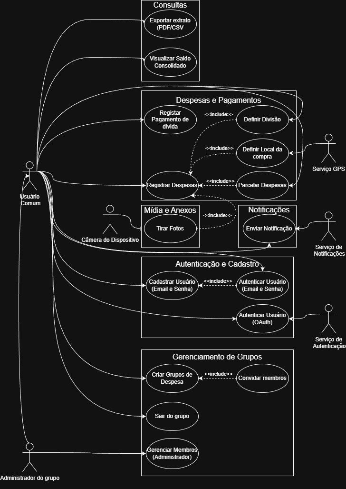
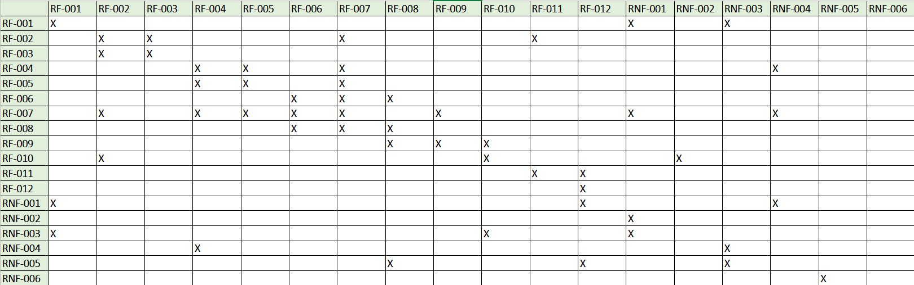
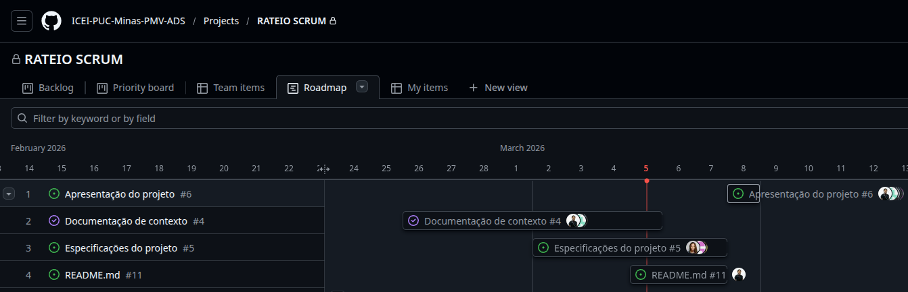
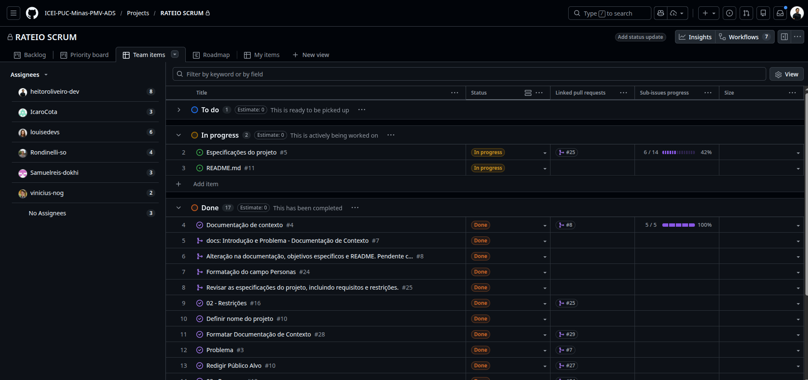

# Especificações do Projeto


Esta seção apresenta a especificação da solução proposta, considerando a perspectiva do usuário final e os requisitos necessários para o desenvolvimento do sistema Rate.io. A partir das informações levantadas na documentação de contexto, são definidas as principais características do sistema, bem como as necessidades e expectativas dos usuários que irão interagir com a aplicação.

O objetivo desta etapa é traduzir o problema identificado em requisitos estruturados, que servirão como base para o desenvolvimento da aplicação e para a definição da arquitetura do sistema.

Para a elaboração desta especificação foram utilizadas técnicas de engenharia de requisitos e modelagem de software, como a criação de personas, definição de histórias de usuário no formato utilizado em metodologias ágeis (Scrum) e organização de requisitos segundo boas práticas de engenharia de software.

Nesta seção serão abordados os seguintes elementos:

```
Personas: representação de perfis fictícios de usuários que refletem características, necessidades e comportamentos do público-alvo da aplicação, auxiliando na compreensão dos diferentes cenários de uso.

Histórias de Usuário: descrição das funcionalidades do sistema a partir da perspectiva do usuário, permitindo identificar necessidades e objetivos que devem ser atendidos pela solução.

Requisitos Funcionais: definição das funcionalidades que o sistema deverá oferecer para atender às necessidades dos usuários, como criação de grupos, registro de despesas e controle de saldos.

Requisitos Não Funcionais: especificação de características relacionadas à qualidade do sistema, como desempenho, segurança, disponibilidade e usabilidade.

Restrições do Projeto: limitações técnicas, tecnológicas ou organizacionais que devem ser consideradas durante o desenvolvimento da aplicação.
```

Esses elementos permitirão estabelecer uma base estruturada para o desenvolvimento do sistema Rate.io, garantindo que a solução proposta atenda às necessidades reais dos usuários e contribua para a melhoria da gestão de despesas compartilhadas.


## Personas


| Característica     | **Carla Mendes**                               | **Bruno Carvalho**                        | **Fernanda Lima**                                  |
| :----------------- | :--------------------------------------------- | :---------------------------------------- | :------------------------------------------------- |
| **Perfil**         | Estudante de Arquitetura (24 anos)             | Analista de TI (31 anos)                  | Designer Freelancer (27 anos)                      |
| **Contexto**       | Divide apartamento com 2 amigas                | Viagens frequentes com amigos             | Trabalha remotamente e divide coworking            |
| **Principal Meio** | Pix e transferências bancárias                 | Cartão de crédito e apps bancários        | Carteiras digitais e Pix                           |
| **Dores**          | Confusão na divisão de compras do mercado      | Controle de gastos de viagens longas      | Divisão de despesas de trabalho compartilhado      |
| **Comportamento**  | Organizada, mas esquece de registrar gastos    | Planejador e detalhista                   | Digital e acostumada a apps financeiros            |
| **Objetivo**       | Saber exatamente quanto cada colega deve pagar | Controlar despesas de grupo sem planilhas | Registrar gastos rapidamente no dia a dia          |
| **Necessidade**    | Divisão automática e histórico de gastos       | Relatórios claros e controle de parcelas  | Registro rápido e sincronização entre dispositivos |


| Característica     | **Diego Martins**                                | **Juliana Rocha**                         | **Pedro Santos**                        |
| :----------------- | :----------------------------------------------- | :---------------------------------------- | :-------------------------------------- |
| **Perfil**         | Estudante de Direito (23 anos)                   | Administradora (33 anos)                  | Engenheiro Civil (34 anos)              |
| **Contexto**       | Mora em república com 5 pessoas                  | Organização de eventos familiares         | Divide despesas de viagens com amigos   |
| **Principal Meio** | Pix e apps de pagamento                          | Transferências bancárias                  | Cartão de crédito                       |
| **Dores**          | Dificuldade em lembrar quem pagou contas da casa | Controle de gastos em eventos grandes     | Divisão desigual de despesas em viagens |
| **Comportamento**  | Prático e quer soluções rápidas                  | Muito organizada e detalhista             | Analítico e focado em planejamento      |
| **Objetivo**       | Evitar discussões sobre dinheiro na república    | Manter controle de quem pagou e quem deve | Ter visão clara das despesas da viagem  |
| **Necessidade**    | Atualização de saldo em tempo real               | Controle de participantes e despesas      | Dashboard simples com resumo financeiro |


## Histórias de Usuários

Com base na análise das personas forma identificadas as seguintes histórias de usuários:

| EU COMO | QUERO                                       | PARA                                             |
| ------- | ------------------------------------------- | ------------------------------------------------ |
| Usuário | Criar um grupo de despesas                  | Organizar contas compartilhadas                  |
| Usuário | Convidar participantes por link ou QR Code  | Facilitar a entrada de novos membros             |
| Usuário | Registrar despesas rapidamente pelo celular | Evitar esquecer gastos                           |
| Usuário | Escolher divisão igualitária                | Dividir despesas simples entre todos             |
| Usuário | Dividir despesas por valor individual       | Garantir justiça em contas de restaurante ou bar |
| Usuário | Registrar quem pagou a despesa              | Manter transparência entre os participantes      |
| Usuário | Visualizar saldo atualizado em tempo real   | Saber quem deve pagar ou receber                 |
| Usuário | Visualizar histórico de despesas do grupo   | Acompanhar gastos anteriores                     |
| Usuário | Receber notificações de novas despesas      | Manter-me informado sobre mudanças no saldo      |
| Usuário | Receber lembretes de pagamento              | Evitar atrasos nas dívidas                       |
| Usuário | Registrar pagamentos realizados             | Atualizar automaticamente os saldos              |
| Usuário | Anexar comprovantes de pagamento            | Garantir transparência nas transações            |
| Usuário | Parcelar despesas compartilhadas            | Controlar pagamentos ao longo dos meses          |
| Usuário | Filtrar despesas por período ou categoria   | Analisar melhor os gastos                        |
| Usuário | Visualizar um resumo financeiro do grupo    | Ter visão clara das despesas totais              |

| EU COMO       | QUERO                                 | PARA                                          |
| ------------- | ------------------------------------- | --------------------------------------------- |
| Administrador | Criar e gerenciar grupos              | Organizar despesas de diferentes contextos    |
| Administrador | Alterar permissões de membros         | Controlar a organização do grupo              |
| Administrador | Remover membros do grupo              | Manter a organização das despesas             |
| Administrador | Editar ou excluir despesas incorretas | Corrigir erros de lançamento                  |
| Administrador | Visualizar relatórios detalhados      | Acompanhar a saúde financeira do grupo        |
| Administrador | Encerrar um grupo de despesas         | Finalizar o controle após um evento ou viagem |

Com base na análise das personas forma identificadas as seguintes histórias de usuários:

| EU COMO | QUERO                                       | PARA                                             |
| ------- | ------------------------------------------- | ------------------------------------------------ |
| Usuário | Criar um grupo de despesas                  | Organizar contas compartilhadas                  |
| Usuário | Convidar participantes por link ou QR Code  | Facilitar a entrada de novos membros             |
| Usuário | Registrar despesas rapidamente pelo celular | Evitar esquecer gastos                           |
| Usuário | Escolher divisão igualitária                | Dividir despesas simples entre todos             |
| Usuário | Dividir despesas por valor individual       | Garantir justiça em contas de restaurante ou bar |
| Usuário | Registrar quem pagou a despesa              | Manter transparência entre os participantes      |
| Usuário | Visualizar saldo atualizado em tempo real   | Saber quem deve pagar ou receber                 |
| Usuário | Visualizar histórico de despesas do grupo   | Acompanhar gastos anteriores                     |
| Usuário | Receber notificações de novas despesas      | Manter-me informado sobre mudanças no saldo      |
| Usuário | Receber lembretes de pagamento              | Evitar atrasos nas dívidas                       |
| Usuário | Registrar pagamentos realizados             | Atualizar automaticamente os saldos              |
| Usuário | Anexar comprovantes de pagamento            | Garantir transparência nas transações            |
| Usuário | Parcelar despesas compartilhadas            | Controlar pagamentos ao longo dos meses          |
| Usuário | Filtrar despesas por período ou categoria   | Analisar melhor os gastos                        |
| Usuário | Visualizar um resumo financeiro do grupo    | Ter visão clara das despesas totais              |

## Administrativo


| EU COMO       | QUERO                                 | PARA                                          |
| ------------- | ------------------------------------- | --------------------------------------------- |
| Administrador | Criar e gerenciar grupos              | Organizar despesas de diferentes contextos    |
| Administrador | Alterar permissões de membros         | Controlar a organização do grupo              |
| Administrador | Remover membros do grupo              | Manter a organização das despesas             |
| Administrador | Editar ou excluir despesas incorretas | Corrigir erros de lançamento                  |
| Administrador | Visualizar relatórios detalhados      | Acompanhar a saúde financeira do grupo        |
| Administrador | Encerrar um grupo de despesas         | Finalizar o controle após um evento ou viagem |


## Requisitos Funcionais

> Prioridade definida pela técnica **MoSCoW** — detalhada na seção correspondente.

| ID | Descrição | Prioridade | Responsável |
|:---|:----------|:----------:|:-----------:|
| `RF-001` | Cadastrar e autenticar usuário (e-mail/senha e OAuth) | 🔴 ALTA | Rondinelli |
| `RF-002` | Criar grupo de despesas com nome e tipo *(república, viagem, lazer)* | 🔴 ALTA | Rondinelli |
| `RF-003` | Convidar membros ao grupo via link compartilhável | 🔴 ALTA | Louise |
| `RF-004` | Registrar despesa com valor, descrição, data e comprovante *(imagem)* | 🔴 ALTA | Louise |
| `RF-005` | Definir tipo de divisão: igualitária, por percentual ou por valor exato | 🔴 ALTA | Samuel |
| `RF-006` | Parcelar despesa em N meses com geração automática de cobranças mensais | 🔴 ALTA | Samuel |
| `RF-007` | Visualizar saldo consolidado individual *(quanto devo / quanto me devem)* | 🔴 ALTA | Heitor |
| `RF-008` | Enviar notificação de vencimento de parcela e cobrança pendente | 🟡 MÉDIA | Heitor |
| `RF-009` | Registrar pagamento de dívida *(marcar como pago com comprovante)* | 🔴 ALTA | Ícaro |
| `RF-010` | Administrador pode alterar permissões e remover membros do grupo | 🟡 MÉDIA | Ícaro |
| `RF-011` | Sair de um grupo *(usuário encerra participação e mantém acesso ao histórico)* | 🟢 BAIXA | Vinicius |
| `RF-012` | Exportar extrato de despesas em PDF ou CSV | 🟢 BAIXA | Vinicius |

---

##  Requisitos Não Funcionais

| ID | Categoria | Descrição | Critério de Aceitação |
|:---|:----------|:----------|:----------------------|
| `RNF-001` | Desempenho | O sistema deve responder às requisições da API em no máximo **2 segundos** em condições normais de uso. | 95% das requisições < 2s medido via teste de carga |
| `RNF-002` |  Disponibilidade | A aplicação deve estar disponível **99% do tempo** (SLA), com janelas de manutenção fora do horário de pico. | Uptime monitorado via serviço em nuvem |
| `RNF-003` |  Segurança | Senhas e tokens armazenados com **criptografia**. Comunicação exclusivamente via **HTTPS/TLS**. Autenticação por **JWT**. | Auditoria de segurança + testes de autenticação |
| `RNF-004` |  Usabilidade | A interface mobile deve permitir o registro de uma despesa em no máximo **4 toques** a partir da tela inicial. | Teste de usabilidade com 5 usuários reais |
| `RNF-005` |  Escalabilidade | A arquitetura em nuvem deve suportar até **500 usuários simultâneos** sem degradação de performance. | Teste de carga com k6 ou JMeter |
| `RNF-006` |  Manutenibilidade | Código seguindo **clean code** com cobertura mínima de **60%** por testes automatizados (unitários/integração). | Relatório de cobertura gerado no CI/CD pipeline |

---

## Restrições

> As restrições limitam as soluções candidatas e devem ser respeitadas durante todo o desenvolvimento.

| ID | Restrição | Justificativa |
|:---|:----------|:--------------|
| `R-01` | Entrega até o final do semestre letivo | O projeto é avaliado dentro do calendário acadêmico vigente, sem possibilidade de prorrogação. |
| `R-02` | Deve usar **arquitetura distribuída** *(Microsserviços com API Gateway)* | Requisito técnico que exige separação entre front-end (web/mobile) e back-end comunicando via API. |
| `R-03` | Deve possuir versão **web** e versão **mobile** funcionais | Ambas as plataformas são obrigatórias para atender os diferentes perfis de uso. |
| `R-04` | Hospedagem obrigatória em **nuvem** *(ex: Render, Railway, Firebase, Vercel)* | A sincronização em tempo real entre dispositivos exige back-end e banco de dados em nuvem. |
| `R-05` | Banco de dados **NoSQL** *(MongoDB)* | Definido no escopo para garantir flexibilidade no esquema de dados e escalabilidade horizontal. A estolha do MongoDB facilita o padrão **Database-per-Service** |
| `R-06` | **Orçamento zero** — utilizar apenas planos gratuitos *(free tier)* | Projeto acadêmico sem financiamento; toda a stack deve operar nos planos gratuitos das plataformas. |

---

##  Priorização MoSCoW

> A técnica **MoSCoW** classifica os requisitos em quatro categorias, permitindo que a equipe foque no que é essencial para a entrega dentro do semestre.  
> A aplicação foi feita em reunião de equipe, avaliando **impacto para o usuário**, **viabilidade técnica** e **dependências entre funcionalidades**.

### Como funciona

```
M — Must Have   → Deve ter obrigatoriamente
S — Should Have → Deveria ter, alta importância
C — Could Have  → Poderia ter, se houver tempo
W — Won't Have  → Não entra neste ciclo
```

### Classificação

| Categoria | Requisitos | Critério |
|:----------|:-----------|:---------|
| 🔴 **Must Have** | `RF-001` `RF-002` `RF-003` `RF-004` `RF-005` `RF-006` `RF-007` `RF-009` | Sem estas funcionalidades o app não cumpre seu propósito central de registrar e dividir despesas. |
| 🟡 **Should Have** | `RF-008` `RF-010` | Agregam valor significativo e melhoram a experiência, mas a ausência não inviabiliza o produto no semestre. |
| 🟢 **Could Have** | `RF-011` `RF-012` | Desejáveis, mas de baixo impacto imediato; implementados somente se houver tempo disponível. |
| ⚪ **Won't Have** | — | Integrações bancárias automáticas, OCR de nota fiscal e suporte a múltiplas moedas ficam fora do escopo deste ciclo. |

---

##  Distribuição entre Integrantes

> Cada integrante é responsável pela execução completa **(back-end + web + mobile)** dos seus requisitos.

| Integrante | Requisitos | Escopo |
|:-----------|:----------:|:-------|
| **Rondinelli** | `RF-001` `RF-002` | Autenticação de usuários · Criação de grupos |
| **Louise** | `RF-003` `RF-004` | Convite de membros · Registro de despesas |
| **Samuel** | `RF-005` `RF-006` | Tipos de divisão · Parcelamento |
| **Heitor** | `RF-007` `RF-008` | Saldo consolidado · Notificações de vencimento |
| **Ícaro** | `RF-009` `RF-010` | Registro de pagamentos · Gestão de permissões |
| **Vinicius** | `RF-011` `RF-012` | Saída de grupo · Exportação de extrato |

---


## Diagrama de Casos de Uso

O diagrama de casos de uso é o próximo passo após a elicitação de requisitos, que utiliza um modelo gráfico e uma tabela com as descrições sucintas dos casos de uso e dos atores. Ele contempla a fronteira do sistema e o detalhamento dos requisitos funcionais com a indicação dos atores, casos de uso e seus relacionamentos. 



## Matriz de Rastreabilidade



# Gerenciamento de Projeto

De acordo com o PMBoK v6 as dez áreas que constituem os pilares para gerenciar projetos, e que caracterizam a multidisciplinaridade envolvida, são: Integração, Escopo, Cronograma (Tempo), Custos, Qualidade, Recursos, Comunicações, Riscos, Aquisições, Partes Interessadas. Para desenvolver projetos um profissional deve se preocupar em gerenciar todas essas dez áreas. Elas se complementam e se relacionam, de tal forma que não se deve apenas examinar uma área de forma estanque. É preciso considerar, por exemplo, que as áreas de Escopo, Cronograma e Custos estão muito relacionadas. Assim, se eu amplio o escopo de um projeto eu posso afetar seu cronograma e seus custos.

## Gerenciamento de Tempo

### Etapa 1

Utilizando a ferramenta do GitHub Project, nossa equipe fez uma boa gestão de projeto seguindo a metodologia ágil SCRUM.



A **gestão do tempo** de execução do projeto foi realizada a partir do gráfico de Gantt, uma ferramenta visual que permitiu com que toda a equipe acompanhasse o andamento da Etapa 1. Com ele, foi possível listar tudo que precisava ser feito para colocar o projeto em prática, dividindo em atividades e estimando o tempo necessário para executá-las, assim como delegando tarefas para todos os componentes da equipe.


## Gerenciamento de Equipe

O gerenciamento adequado de tarefas contribuiu para que o projeto níveis de produtividade adequados para cumprir os prazos de entrega estabelecidos. Por isso, foi fundamental usufruir dos recursos tecnologicos dispoíveis para gestão de tarefas e de pessoas oferecidas pelo Github, de modo que os membros da equipe pudessem ser facilmente integrados e engajados na elaboração do projeto através da distribuição de tarefas. 

Com o campo *Team Items*, foi possível verificar todas as tarefas e sub-tarefas geradas durante as etapas, assim como o seu andamento no quadro Kanban e qual membro da equipe estava responsável por sua execução.



<br>

## Planejamento de Recursos

Para o projeto **RATE.IO**, o planejamento de custos e pessoal reflete a realidade de um grupo acadêmico, priorizando ferramentas com camadas gratuitas para viabilizar a entrega do MVP em um ciclo de entrega curto, cumprindo o primeiro semestre letivo de 2026.

---

## 1. Planejamento de Pessoal

Devido ao prazo enxuto e ao tamanho reduzido do grupo, adotamos uma divisão híbrida. Embora todos colaborem no ecossistema, cada integrante possui responsabilidades centrais para garantir a especialização e a fluidez do **GitFlow**:

| Papel | Responsabilidades Principais | Responsável |
| :--- | :--- | :--- |
| **Backend Developer** | Construção da API REST, lógica de cálculos de saldo (rateio) e integração com MongoDB Atlas. | Heitor e Rondinelli |
| **Frontend Developer (Web)** | Desenvolvimento do Dashboard gerencial e integração de gráficos de consumo. | Vinícius e Samuel |
| **Mobile Developer** | Desenvolvimento da interface de lançamentos rápidos e notificações para o usuário final. | Icaro e Louise |
| **QA & DevOps** | Configuração do fluxo de CI/CD, testes de integração e deploy nas plataformas Cloud. | Heitor |

---

## 2. Planejamento de Custos

O objetivo técnico é operar uma **arquitetura distribuída com custo zero** de infraestrutura, aproveitando os limites gratuitos dos provedores de nuvem modernos.

### 2.1 Custos de Infraestrutura (Estimados)

| Item | Provedor Sugerido | Custo Mensal | Justificativa |
| :--- | :--- | :--- | :--- |
| **Hospedagem API** | Render.com / Railway | R$ 0,00 | Camada gratuita para aplicações web hobby/estudo. |
| **Banco de Dados** | MongoDB Atlas | R$ 0,00 | Cluster compartilhado gratuito (512MB a 5GB). |
| **Hospedagem Web** | Vercel / Netlify | R$ 0,00 | Hospedagem de alta performance para frameworks SPA (React/Vue). |
| **Domínio** | Subdomínio padrão | R$ 0,00 | Uso de subdomínios gratuitos fornecidos pelos provedores. |
| **Total Estimado** | -- | **R$ 0,00** | Foco em viabilidade acadêmica e custo zero. |

### 2.2 Custos de Pessoal (Horas Técnicas)

Para fins de análise do "custo de oportunidade" acadêmico, baseamos o cálculo no valor de mercado para desenvolvedores em transição/Júnior em Minas Gerais:

* **Esforço estimado:** 10 horas semanais por integrante.
* **Valor hora sugerido:** R$ 30,00.
* **Cálculo (8 semanas):** 6 integrantes × 80h totais × R$ 30,00 = **R$ 14.400,00** (Custo simbólico de desenvolvimento).

---

## 3. Justificativa de Recursos

A seleção da stack tecnológica (**Node.js, React e MongoDB**) fundamenta-se na vasta documentação disponível e na agilidade de desenvolvimento, fatores críticos para o cronograma de 8 semanas. 

A utilização de serviços de **nuvem distribuídos** garante que a aplicação permaneça disponível 24/7 sem a necessidade de infraestrutura física local, validando os conceitos de escalabilidade e disponibilidade essenciais para a disciplina de Sistemas Distribuídos.
