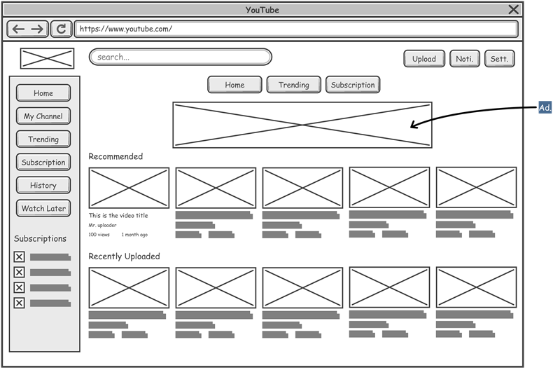

 Projeto de Interface

<span style="color:red">Pré-requisitos: <a href="2-Especificação do Projeto.md"> Documentação de Especificação</a></span>

Visão geral da interação do usuário pelas telas do sistema e protótipo interativo das telas com as funcionalidades que fazem parte do sistema (wireframes), tanto da versão web como para a versão mobile.

Apresente as principais interfaces da plataforma. Discuta como ela foi elaborada de forma a atender os requisitos funcionais, não funcionais e histórias de usuário abordados nas <a href="2-Especificação do Projeto.md"> Documentação de Especificação</a>.

## Diagrama de Fluxo


### Diagrama criado com código flowchart
```
flowchart TD
    %% Estilos customizados
    classDef startEnd fill:#1A1A3A,stroke:#4F33C7,stroke-width:2px,color:#fff;
    classDef page fill:#2C2C54,stroke:#4F33C7,stroke-width:1px,color:#fff;
    classDef action fill:#4F33C7,stroke:#fff,stroke-width:1px,color:#fff;
    classDef decision fill:#0C7C4F,stroke:#fff,stroke-width:1px,color:#fff;

    %% Início do Fluxo
    A([Início / Acesso ao Rate.io]):::startEnd --> B{Autenticado?}:::decision
    
    %% Autenticação
    B -- Não --> C[Landing Page]:::page
    C --> C1[AuthPage: Login / Register]:::page
    C1 --> C2(Autenticação via API):::action
    C2 --> D[Dashboard]:::page
    B -- Sim --> D

    %% Dashboard / Navegação Principal
    D --> E{Ação do Usuário}:::decision
    E -- Quitar Pendência --> F[Dashboard: Lista de Pendências]:::page
    E -- Acessar Grupos --> G[GroupPage: Meus Grupos]:::page
    
    %% Fluxo de Grupos (GroupDetailPage)
    G --> G1(Criar Novo Grupo):::action
    G --> G2[GroupDetailPage: Visão do Grupo]:::page
    
    G2 --> G3(Convidar/Adicionar Membros):::action
    G2 --> G4(Criar Nova Despesa):::action
    G2 --> G5(Visualizar Balanço/Resumo):::action
    
    %% Criação de Despesa (Sprint 2)
    G4 --> G4a("Selecionar Tipo: Igual, % ou Exato"):::action
    G4a --> G4b(Salvar no MongoDB):::action
    G4b --> G2

    %% Fluxo de Pagamento (Settle)
    F --> H[Modal de Pagamento]:::page
    G2 --> |Botão Registrar Pagamento| H
    
    H --> H1(Preencher Valor Parcial/Total):::action
    H1 --> H2(Anexar Comprovante de PG):::action
    H2 --> H3(Enviar POST /settle via FormData):::action
    
    H3 --> H4{API Retornou Sucesso?}:::decision
    H4 -- Erro 400/500 --> H5(Exibir Toast de Erro):::action
    H5 --> H
    
    H4 -- Sucesso 200 --> H6(Exibir Toast de Sucesso):::action
    H6 --> H7(Atualizar Saldos e Mapa de Despesas):::action
    H7 --> D
```

## Wireframes



São protótipos usados em design de interface para sugerir a estrutura de um site web e seu relacionamentos entre suas páginas. Um wireframe web é uma ilustração semelhante do layout de elementos fundamentais na interface.

> **Links Úteis**:
>
> - [Protótipos vs Wireframes](https://www.nngroup.com/videos/prototypes-vs-wireframes-ux-projects/)
> - [Ferramentas de Wireframes](https://rockcontent.com/blog/wireframes/)
> - [MarvelApp](https://marvelapp.com/developers/documentation/tutorials/)
> - [Figma](https://www.figma.com/)
> - [Adobe XD](https://www.adobe.com/br/products/xd.html#scroll)
> - [Axure](https://www.axure.com/edu) (Licença Educacional)
> - [InvisionApp](https://www.invisionapp.com/) (Licença Educacional)
