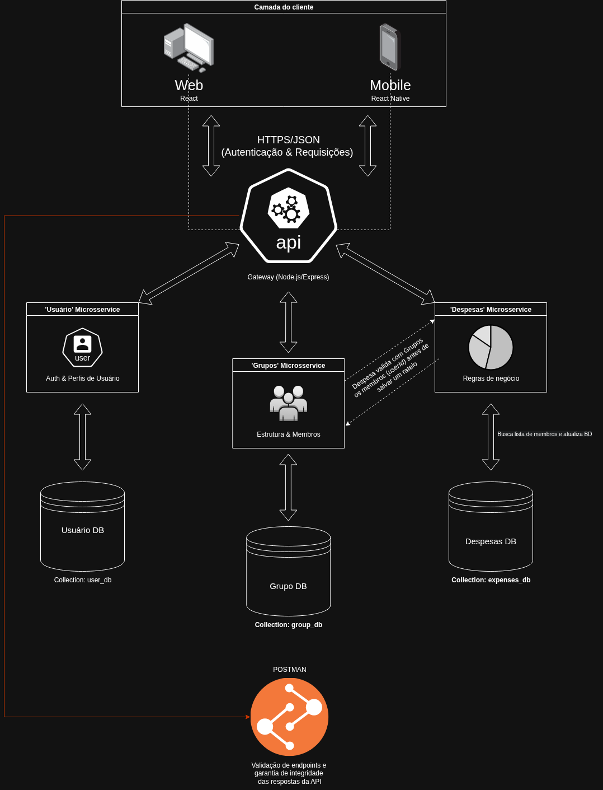

# Arquitetura da Solução

## Definição e Documentação da Arquitetura Distribuída

### Diagrama de Arquitetura Distribuída

Abaixo, apresentamos o diagrama que ilustra a integração crítica entre os componentes do sistema **RATE.IO**, detalhando o fluxo de comunicação entre os clientes, a API centralizada e a persistência de dados na nuvem.



### Detalhamento dos Componentes

A nova arquitetura do projeto é fundamentada em Microsserviços com soberania de dados. O diagrama acima ilustra a separação física e lógica dos componentes, o fluxo de comunicação via rede e a descentralização de dados no **MongoDB Atlas**.

A estrutura do RATE.IO foi projetada para garantir baixo acoplamento e alta coesão, permitindo que cada módulo evolua independentemente. A arquitetura divide-se em quatro camadas principais:

#### 1. Camada de Cliente (Aparelhos do Usuário)
Esta camada representa os *front-ends* heterogêneos. Eles são "clientes magros" (*thin clients*), pois não possuem lógica de negócio ou acesso direto ao banco de dados.

* **Aplicações Web (React) e Mobile (React Native):** Fazem requisições assíncronas via rede utilizando o protocolo **HTTPS** e o formato **JSON**.
* **Navegador/Celular:** São os ambientes de execução que renderizam a interface e gerenciam o estado local da aplicação.

#### 2. Camada de Comunicação e Segurança (Internet/Rede)
A "Nuvem" representa a infraestrutura de rede pública (Internet) que conecta os clientes ao servidor.

* **HTTPS/JSON:** É o protocolo de comunicação padrão, garantindo a criptografia dos dados financeiros em trânsito.
* **JWT (JSON Web Token):** Utilizado para autenticação *stateless*. Após o login, o cliente envia o token no cabeçalho de cada requisição para validar sua identidade na API.
* **Postman:** Atua como um cliente externo nesta camada, permitindo que a equipe de QA/DevOps valide os *endpoints* da API independentemente dos *front-ends*.

#### 3. Camada de Aplicação (Microsserviços Autônomos)
A lógica de negócio foi dividida em três serviços independentes:

* **Users Service**: Gerencia o ciclo de vida do usuário (registro, login, perfil).

* **Groups Service**: Gerencia a estrutura do grupo, membros, administradores e os saldos consolidados dos participantes (necessário para o RF-007).

* **Expenses Service**: Contém o motor de cálculo de rateio (RF-005) e gerencia o histórico de transações brutas.

#### 4. Camada de Dados (NoSQL Descentralizado)
A persistência de dados foi descentralizada no MongoDB Atlas, onde cada microsserviço possui seu próprio banco de dados NoSQL isolado, garantindo a soberania de dados:

* ```users_db```: Armazena apenas perfis e credenciais criptografadas.

* ```groups_db```: Armazena a estrutura do grupo e o saldo consolidado de cada membro (balance).

* ```expenses_db```: Armazena o histórico bruto de transações e fotos de comprovantes.

---

#### Barramento de comunicação interna

Devido a descentralização dos banco de dados, o sistema agora depende de chamadas de rede para buscar e sincronizar dados entre os serviços, um conceito fundamental em sistemas distribuídos.

* Fluxo Crítico (RF-004 e RF-005): Ao registrar uma despesa, o Expenses Service faz chamadas assíncronas (via HTTP) para o Groups Service para validar membros e, após o cálculo, notificar atualizações de saldo, garantindo a integridade dos dados entre as entidades.

---

#### Camada de testes e QA (Postman)
* **Postman**: Integrado ao Gateway, é utilizado como cliente externo para validar os endpoints e garantir a integridade das respostas da API, independentemente das interfaces finais.

## Diagrama de Classes

O diagrama de classes ilustra graficamente como será a estrutura do software, e como cada uma das classes da sua estrutura estarão interligadas. Essas classes servem de modelo para materializar os objetos que executarão na memória.

As referências abaixo irão auxiliá-lo na geração do artefato “Diagrama de Classes”.

> - [Diagramas de Classes - Documentação da IBM](https://www.ibm.com/docs/pt-br/rational-soft-arch/9.6.1?topic=diagrams-class)
> - [O que é um diagrama de classe UML? | Lucidchart](https://www.lucidchart.com/pages/pt/o-que-e-diagrama-de-classe-uml)

## Documentação do Banco de Dados MongoDB

Este documento descreve a estrutura e o esquema do banco de dados não relacional utilizado por nosso projeto, baseado em MongoDB. O MongoDB é um banco de dados NoSQL que armazena dados em documentos JSON (ou BSON, internamente), permitindo uma estrutura flexível e escalável para armazenar e consultar dados.

## Esquema do Banco de Dados
### Coleção: users
Armazena as informações dos usuários do sistema.

Estrutura do Documento

```JSON
{
    "_id": "user123",
    "name": "Heitor Oliveiro",
    "email": "heitor.ol@example.com",
    "passwordHash": "$2b$10$hashed_password",
    "createdAt": "2024-08-29T10:00:00Z",
    "updatedAt": "2024-08-29T12:00:00Z"
}
```

#### Descrição dos Campos
> - <strong>_id:</strong> Identificador único do usuário gerado automaticamente pelo MongoDB.
> - <strong>name:</strong> Nome completo do usuário.
> - <strong>email:</strong> Endereço de email do usuário.
> - <strong>passwordHash:</strong> Hash da senha do usuário.
> - <strong>createdAt:</strong> Data e hora de criação do usuário.
> - <strong>updatedAt:</strong> Data e hora da última atualização dos dados do usuário.

### Coleção: groups
Armazena a estrutura do grupo e o saldo consolidade de cada membro.

```Json
{
    "_id": "groupA1B2",
    "name": "Viagem para Porto Seguro",
    "description": "Descrição opcional do grupo.",
    "type": "Viagem", // RF-003 (Flexibilidade)
    "adminId": "user123", // _id de quem criou o grupo
    "members": [
        {
            "userId": "user123",
            "name": "Heitor Oliveiro",
            "balance": 50.0 // Usuário pagou a mais e deve receber
        }
        {
            "userId": "user456",
            "name": "Rondinelli",
            "balance": -50.0 // Usuário deve pagar
        }
    ],
    "createdAt": "2024-08-29T10:30:00Z",
    "updatedAt": "2024-08-29T11:30:00Z"
}
```

#### Descrição dos Campos
> - <strong>_id:</strong> Identificador único do grupo, gerado automaticamente pelo MongoDB.
> - <strong>name:</strong> Nome do grupo.
> - <strong>description:</strong> Descrição do grupo (opcional).
> - <strong>type:</strong> Categoria do grupo de despesas.
> - <strong>adminId:</strong> Referencia o usuário que criou o grupo.
> - <strong>members:</strong> Todos os usuários que participam do grupo de despesas.
> - <strong>createdAt:</strong> Data e hora de criação do usuário.
> - <strong>updatedAt:</strong> Data e hora da última atualização dos dados do usuário.

### Coleção: expenses
Armazena as despesas de cada grupo disponíveis no sistema.

Estrutura do Documento

```Json
{
  "_id": "expenseXYZ",
  "groupId": "groupA1B2", // Referência para saber a qual grupo pertence
  "description": "Aluguel do Airbnb",
  "totalAmount": 1000.0,
  "paidById": "user123", // O Heitor pagou o total
  "divisionType": "Equal", // RF-005 (Motor de cálculo do backend)
  "details": [
    {
      "userId": "user123", // Heitor
      "amountToPay": 500.0 // Sua parte na divisão
    },
    {
      "userId": "user456", // Rondinelli
      "amountToPay": 500.0 // Sua parte na divisão
    }
  ],
  "receiptPhotoUrl": "https://s3.render.com/receipts/expenseXYZ.jpg", // RF-004
  "createdAt": "2024-10-26T11:00:00Z"
}
```

#### Descrição dos Campos
> - <strong>_id:</strong> Identificador único da despesa gerado automaticamente pelo MongoDB.
> - <strong>groupId:</strong> Referencia o grupo ao qual a despesa pertence.
> - <strong>description:</strong> Descrição da despesa.
> - <strong>totalAmount:</strong> Total da despesa.
> - <strong>amountToPay:</strong> Parte da divisão de cada usuário a pagar .
> - <strong>paidById:</strong> Identificador de qual membro pagou o total.
> - <strong>divisionType:</strong> Tipo de divisao, se em porcentagem, igualitaria.
> - <strong>details:</strong> Detalhes da divisao.
> - <strong>receiptPhotoUrl:</strong> Upload de fotos de comprovantes.
> - <strong>createdAt:</strong> Data e hora de criação do produto.
> - <strong>updatedAt:</strong> Data e hora da última atualização dos dados do produto.

### Boas Práticas

Validação de Dados: Implementar validação de esquema e restrições na aplicação para garantir a consistência dos dados.

Monitoramento e Logs: Utilize ferramentas de monitoramento e logging para acompanhar a saúde do banco de dados e diagnosticar problemas.

Escalabilidade: Considere estratégias de sharding e replicação para lidar com crescimento do banco de dados e alta disponibilidade.

### Material de Apoio da Etapa

Na etapa 2, em máterial de apoio, estão disponíveis vídeos com a configuração do mongo.db e a utilização com Bson no C#


## Modelo ER (Somente se tiver mais de um banco e outro for relacional)

O Modelo ER representa através de um diagrama como as entidades (coisas, objetos) se relacionam entre si na aplicação interativa.

As referências abaixo irão auxiliá-lo na geração do artefato “Modelo ER”.

> - [Como fazer um diagrama entidade relacionamento | Lucidchart](https://www.lucidchart.com/pages/pt/como-fazer-um-diagrama-entidade-relacionamento)

## Esquema Relacional (Somente se tiver mais de um banco e outro for relacional)

O Esquema Relacional corresponde à representação dos dados em tabelas juntamente com as restrições de integridade e chave primária.
 
As referências abaixo irão auxiliá-lo na geração do artefato “Esquema Relacional”.

> - [Criando um modelo relacional - Documentação da IBM](https://www.ibm.com/docs/pt-br/cognos-analytics/10.2.2?topic=designer-creating-relational-model)

## Modelo Físico (Somente se tiver mais de um banco e outro for relacional)

Entregar um arquivo banco.sql contendo os scripts de criação das tabelas do banco de dados. Este arquivo deverá ser incluído dentro da pasta src\bd.

## Tecnologias Utilizadas

Descreva aqui qual(is) tecnologias você vai usar para resolver o seu problema, ou seja, implementar a sua solução. Liste todas as tecnologias envolvidas, linguagens a serem utilizadas, serviços web, frameworks, bibliotecas, IDEs de desenvolvimento, e ferramentas.

Apresente também uma figura explicando como as tecnologias estão relacionadas ou como uma interação do usuário com o sistema vai ser conduzida, por onde ela passa até retornar uma resposta ao usuário.

## Hospedagem

Explique como a hospedagem e o lançamento da plataforma foi feita.

> **Links Úteis**:
>
> - [Website com GitHub Pages](https://pages.github.com/)
> - [Programação colaborativa com Repl.it](https://repl.it/)
> - [Getting Started with Heroku](https://devcenter.heroku.com/start)
> - [Publicando Seu Site No Heroku](http://pythonclub.com.br/publicando-seu-hello-world-no-heroku.html)

## Qualidade de Software

Conceituar qualidade de fato é uma tarefa complexa, mas ela pode ser vista como um método gerencial que através de procedimentos disseminados por toda a organização, busca garantir um produto final que satisfaça às expectativas dos stakeholders.

No contexto de desenvolvimento de software, qualidade pode ser entendida como um conjunto de características a serem satisfeitas, de modo que o produto de software atenda às necessidades de seus usuários. Entretanto, tal nível de satisfação nem sempre é alcançado de forma espontânea, devendo ser continuamente construído. Assim, a qualidade do produto depende fortemente do seu respectivo processo de desenvolvimento.

A norma internacional ISO/IEC 25010, que é uma atualização da ISO/IEC 9126, define oito características e 30 subcaracterísticas de qualidade para produtos de software.
Com base nessas características e nas respectivas sub-características, identifique as sub-características que sua equipe utilizará como base para nortear o desenvolvimento do projeto de software considerando-se alguns aspectos simples de qualidade. Justifique as subcaracterísticas escolhidas pelo time e elenque as métricas que permitirão a equipe avaliar os objetos de interesse.

> **Links Úteis**:
>
> - [ISO/IEC 25010:2011 - Systems and software engineering — Systems and software Quality Requirements and Evaluation (SQuaRE) — System and software quality models](https://www.iso.org/standard/35733.html/)
> - [Análise sobre a ISO 9126 – NBR 13596](https://www.tiespecialistas.com.br/analise-sobre-iso-9126-nbr-13596/)
> - [Qualidade de Software - Engenharia de Software 29](https://www.devmedia.com.br/qualidade-de-software-engenharia-de-software-29/18209/)
