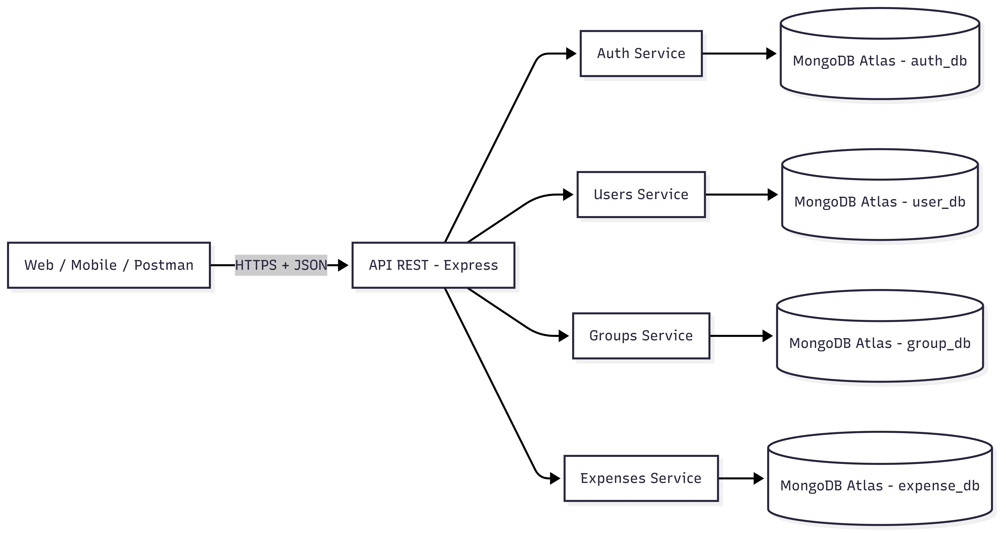
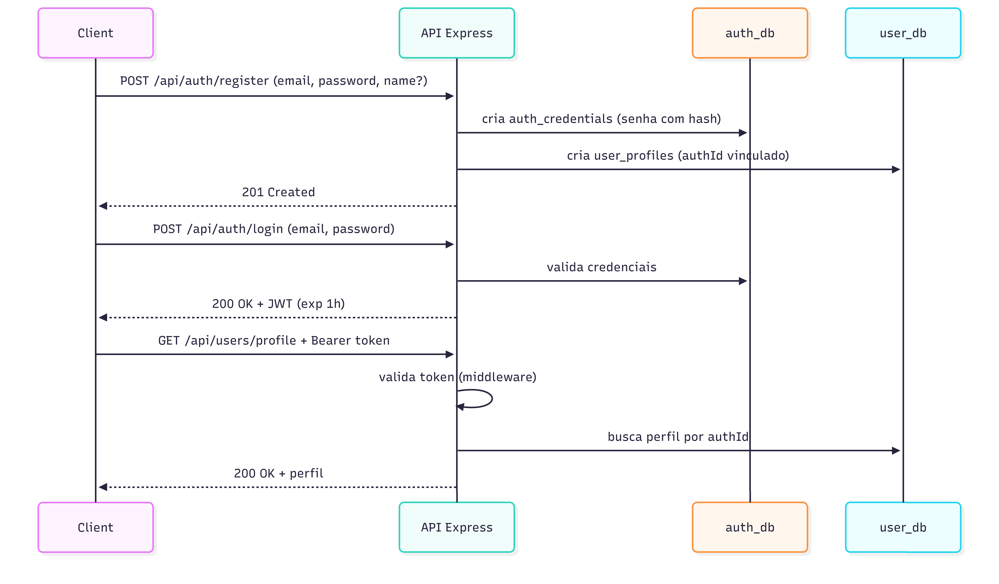
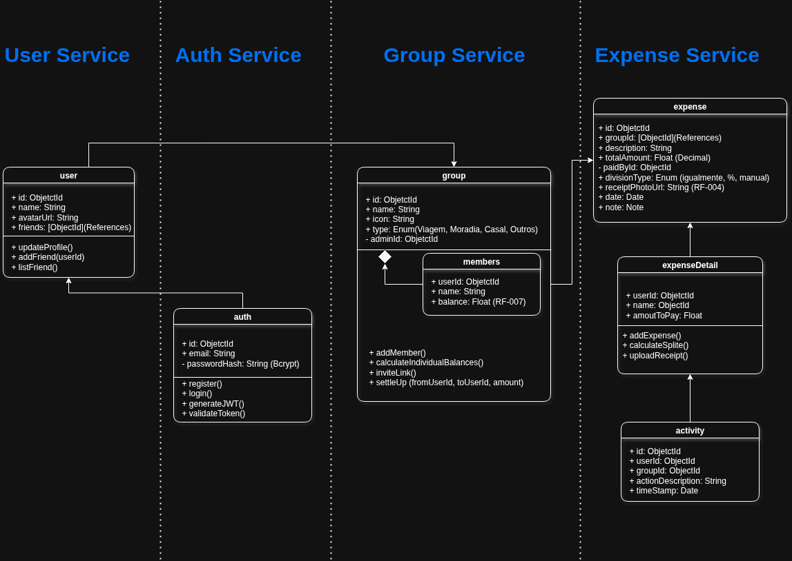
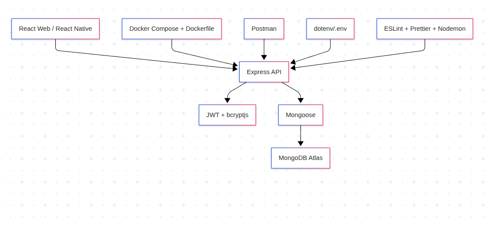

# Arquitetura da Solução

## Definição e Documentação da Arquitetura Distribuída

### Diagrama de Arquitetura Distribuída

Abaixo, apresentamos o diagrama que ilustra a integração crítica entre os componentes do sistema **RATE.IO**, detalhando o fluxo de comunicação entre os clientes, a API centralizada e a persistência de dados na nuvem.


### Detalhamento dos Componentes

A arquitetura do RATE.IO evoluiu para um modelo **orientado a API** com separação de responsabilidades por domínio e soberania de dados por banco. No estado atual, os módulos de **Auth**, **Users**, **Groups** e **Expenses** já estão implementados e operacionais no backend.

A solução está organizada em quatro camadas:

#### 1. Camada de Cliente (Web e Mobile)

- **Web (React) e Mobile (React Native):** consumidores da API REST via HTTPS/JSON.
- **Cliente leve (thin client):** sem acesso direto ao banco e sem regra de negócio crítica no frontend.

#### 2. Camada de API e Segurança

- **API REST em Node.js + Express:** ponto único de entrada para consumo de recursos.
- **Autenticação stateless com JWT:** emissão no login e envio no header `Authorization: Bearer <token>`.
- **CORS + validação de entrada:** proteção de borda para acesso entre origens e consistência de payloads.
- **Postman:** cliente de QA para validação funcional dos endpoints.

#### 3. Camada de Domínio (Serviços)

- **Auth Service (implementado):** registro, login, hash de senha e emissão de token.
- **Users Service (implementado):** criação automática e manutenção de perfil de usuário.
- **Groups Service (implementado):** gestão de grupos, membros, histórico de atividades e remoção lógica.
- **Expenses Service (implementado):** gestão de despesas, divisão, quitação de partes e cálculo de saldos.

#### 4. Camada de Dados (MongoDB NoSQL)

- **`auth_db` (implementado):** coleção `auth_credentials`.
- **`user_db` (implementado):** coleção `user_profiles`.
- **`group_db` (implementado):** coleções `groups` e `activities`.
- **`expense_db` (implementado):** coleção `expenses`.

### Arquitetura da Solução Baseada em API

O diagrama abaixo representa o fluxo principal implementado na API, incluindo autenticação, usuários, grupos e despesas.



#### Justificativas arquiteturais

- **Escalabilidade por domínio:** cada serviço pode crescer com seu próprio ciclo de deploy e volume de dados.
- **Baixo acoplamento:** separação entre autenticação e perfil reduz impacto de mudanças entre módulos.
- **Soberania de dados:** cada domínio mantém seu banco, reduzindo dependências de esquema entre contextos.
- **Segurança:** JWT evita sessão em memória no servidor e simplifica a autenticação distribuída.
- **Evolução incremental:** permitiu entregar Auth/Users primeiro e evoluir para Groups/Expenses mantendo o mesmo contrato de API.

## Documentação da Implementação da Web API REST

### Stack de implementação
* Runtime: Node.js 18+
* Framework HTTP: Express 5
* Persistência: Mongoose + MongoDB Atlas
* Segurança: bcryptjs (hash) + jsonwebtoken (JWT)
* Configuração: dotenv
* Qualidade: ESLint + Prettier
* Padronização de ambiente: Docker + Docker Compose

### Execução e padronização de ambiente (Docker)

A execução de desenvolvimento do backend está padronizada com containerização, com os seguintes artefatos:

1. `docker-compose.yml` na raiz do repositório (orquestração do ambiente local).
2. `src/backend/Dockerfile` com multi-stage (`development` e `production`).
3. `src/backend/.dockerignore` para reduzir contexto de build e evitar inclusão de segredos.
4. `src/backend/.env.example` para onboarding seguro sem credenciais reais.

Fluxo padrão no ambiente local:

1. Criar `src/backend/.env` a partir de `.env.example`.
2. Preencher variáveis obrigatórias de conexão (`MONGO_URI_AUTH`, `MONGO_URI_USERS`) e `JWT_SECRET`.
3. Subir com `docker compose up --build`.
4. Validar disponibilidade em `/health`.

### Configurações de ambiente

As variáveis abaixo são usadas para execução local e integração com os bancos:

```env
PORT=3000
JWT_SECRET=<chave-jwt-segura>
MONGO_URI_AUTH=<uri-auth_db>
MONGO_URI_USERS=<uri-user_db>
MONGO_URI_GROUPS=<uri-group_db>
MONGO_URI_EXPENSES=<uri-expense_db>
```

Regras relevantes do setup atual:

- `MONGO_URI_AUTH`, `MONGO_URI_USERS`, `MONGO_URI_GROUPS` e `MONGO_URI_EXPENSES` são obrigatórias para subir o backend.
- O backend inicia apenas após validação e conexão com os bancos obrigatórios.
- Em produção, falha de conexão encerra o processo para evitar API em estado inconsistente.

### Modelagem implementada

#### Modelo `Auth` (`auth_credentials`)

- `email` (único, obrigatório, validado)
- `password` (hash via hook `pre('save')`)
- `lastLogin` (data do último acesso)
- `isActive` (controle lógico de ativação)
- `createdAt` e `updatedAt` (timestamps automáticos)

#### Modelo `User` (`user_profiles`)

- `name` (obrigatório, mínimo de 2 caracteres)
- `email` (único, obrigatório)
- `authId` (referência ao usuário autenticado)
- `avatarUrl` (opcional)
- `isActive` (status lógico)
- `createdAt` e `updatedAt` (timestamps automáticos)

#### Modelo `Group` (`groups`)

- `name` (obrigatório, trim, mínimo de 2 e máximo de 100 caracteres)
- `description` (opcional, trim, máximo de 300 caracteres)
- `createdBy` (ObjectId obrigatório do usuário criador)
- `members` (array com `userId`, `role` = `admin|member` e `joinedAt`)
- `isActive` (status lógico para remoção suave)
- `createdAt` e `updatedAt` (timestamps automáticos)
- Índice: `members.userId`

#### Modelo `Expense` (`expenses`)

- `groupId` (ObjectId obrigatório, indexado)
- `description` (obrigatória, trim, máximo de 255 caracteres)
- `amount` (obrigatório, mínimo de 0.01)
- `currency` (default `BRL`, enum `BRL|USD`, uppercase)
- `paidBy` (ObjectId obrigatório do pagador)
- `createdBy` (ObjectId obrigatório de quem criou a despesa)
- `splitType` (enum `igual|porcentagem|exato`, default `igual`)
- `splits` (array obrigatório com `userId`, `amount`, `percentage`, `status`, `paidAt`)
- `createdAt` e `updatedAt` (timestamps automáticos)
- Índice composto: `{ groupId: 1, createdAt: -1 }`

#### Modelo `Activity` (`activities`)

- `groupId` (ObjectId obrigatório, indexado)
- `actorUserId` (ObjectId obrigatório, indexado)
- `targetUserId` (ObjectId opcional, indexado)
- `type` (enum `GROUP_CREATED|MEMBER_ADDED|EXPENSE_CREATED|PAYMENT_SETTLED|GROUP_DELETED`)
- `message` (obrigatória, trim, máximo de 300 caracteres)
- `metadata` (Mixed, default `{}`)
- `createdAt` e `updatedAt` (timestamps automáticos)
- Índice composto: `{ groupId: 1, createdAt: -1 }`

### Autenticação e autorização

Fluxo implementado:

1. Cliente realiza login com email e senha.
2. API valida credenciais e retorna JWT com expiração de 1 hora.
3. Cliente envia token no header `Authorization`.
4. Middleware valida formato Bearer, assinatura e validade.
5. Dados decodificados são anexados em `req.user` para consumo nas rotas protegidas.

Tratamento de erro de autenticação:

- Token ausente: `401 AUTH_TOKEN_MISSING`
- Formato inválido: `401 AUTH_TOKEN_FORMAT_INVALID` / `AUTH_TOKEN_SCHEME_INVALID`
- Token expirado: `401 AUTH_TOKEN_EXPIRED`
- Token inválido: `401 AUTH_TOKEN_INVALID`

### Recursos e rotas da API (estado atual)

#### Base URL local

`http://localhost:3000`

#### Rotas públicas

| Método | Rota                 | Descrição                                         |
| ------ | -------------------- | ------------------------------------------------- |
| GET    | `/`                  | Health-check simples da API                       |
| POST   | `/api/auth/register` | Cadastra credencial e cria perfil automaticamente |
| POST   | `/api/auth/login`    | Autentica usuário e retorna JWT                   |

#### Rotas protegidas (`Authorization: Bearer <token>`)

| Método | Rota                                    | Descrição                                                                    |
| ------ | --------------------------------------- | ---------------------------------------------------------------------------- |
| POST   | `/api/users`                            | Cria perfil (fallback para fluxos sem criação automática)                    |
| GET    | `/api/users/profile`                    | Retorna perfil ativo associado ao `authId` do token                          |
| PUT    | `/api/users/profile`                    | Atualiza `name` e/ou `avatarUrl` do perfil                                   |
| POST   | `/api/groups`                           | Cria grupo e registra atividade de criação                                    |
| POST   | `/api/groups/:groupId/members`          | Adiciona membro existente ao grupo                                            |
| POST   | `/api/groups/:groupId/invite`           | Adiciona membro por email (usuário já cadastrado)                            |
| GET    | `/api/groups/user/:userId`              | Lista grupos ativos em que o usuário participa                                |
| GET    | `/api/groups/:groupId/activities`       | Lista atividades do grupo (requer `userId` em query)                         |
| DELETE | `/api/groups/:groupId`                  | Remove grupo logicamente (`isActive=false`) se não houver despesas pendentes |
| POST   | `/api/expenses`                         | Cria despesa com divisão por tipo (`igual`, `porcentagem`, `exato`)          |
| GET    | `/api/expenses/group/:groupId`          | Lista despesas do grupo (requer `userId` em query)                           |
| POST   | `/api/expenses/:expenseId/settle`       | Marca a parte de um usuário como paga em uma despesa                         |
| GET    | `/api/expenses/group/:groupId/balances` | Retorna saldo consolidado de um usuário no grupo (requer `userId` em query)  |

### Fluxo de implementação REST (registro e autenticação)



## Diagrama de Classes

O diagrama de classes ilustra graficamente como será a estrutura do software, e como cada uma das classes da sua estrutura estarão interligadas. Essas classes servem de modelo para materializar os objetos que executarão na memória.



## Documentação do Banco de Dados MongoDB

Este documento descreve a estrutura e o esquema do banco de dados não relacional utilizado por nosso projeto, baseado em MongoDB. O MongoDB é um banco de dados NoSQL que armazena dados em documentos JSON (ou BSON, internamente), permitindo uma estrutura flexível e escalável para armazenar e consultar dados.

## Esquema do Banco de Dados

### auth_db

Focado na autenticação, segurança e credenciais de usuário

```JSON

// Coleção: auth_credentials
{
    "_id": "ObjectId", // referencia para outros serviços
    "email": {
      "type": "String",
      "unique": true,
      "required": true
    },
    "password": {
      "type": "String",
      "required": true
    },
    "lastLogin": {
      "type": "Date",
      "default": null
    },
    "isActive": {
      "type": "Boolean",
      "default": true
    },
    "createdAt": {
      "type": "Date",
      "default": "Date.now"
    },
    "updatedAt": {
      "type": "Date",
      "default": "Date.now"
    }
}
```

Implementação atual no backend:

- Coleção utilizada: `auth_credentials`
- Índice único em `email` para evitar duplicidade de credencial.
- Senha persistida com hash BCrypt (não armazenada em texto puro).
- Campo `lastLogin` atualizado no login com sucesso.

### user_db

Armazena o perfil do usuário e informações de apresentação.

```JSON
// Coleção: user_profiles
{
    "_id": "ObjectId",
    "authId": "ObjectId", // id do documento em auth_credentials
    "email": {
      "type": "String",
      "unique": true,
      "required": true
    },
    "name": {
      "type": "String",
      "required": true
    },
    "avatarUrl": "String",
    "isActive": "Boolean",
    "createdAt": "2024-08-29T10:00:00Z",
    "updatedAt": "2024-08-29T12:00:00Z"
}
```

Implementação atual no backend:

- Coleção utilizada: `user_profiles`
- Vínculo com autenticação por `authId`.
- Método de acesso principal: busca por `authId` ativo (`findByAuthId`).
- Criação do perfil ocorre automaticamente no registro e pode ser feita também por rota protegida.

### group_db

Armazena a estrutura do grupo e o histórico de atividades de colaboração.

```Json
// Coleção: groups
{
    "_id": "ObjectId",
    "name": {
      "type": "String",
      "required": true
    },
    "description": {
      "type": "String",
      "maxlength": 300
    },
    "createdBy": "ObjectId", // _id de quem criou o grupo
    "members": [
        {
            "userId": "ObjectId", // Referência ao _id de user_profiles
            "role": {
              "type": "String",
              "enum": ["admin", "member"],
              "default": "member"
            },
            "joinedAt": {
              "type": "Date",
              "default": "Date.now"
            }
        },
    ],
    "isActive": {
      "type": "Boolean",
      "default": true
    },
    "createdAt": "2024-08-29T10:30:00Z",
    "updatedAt": "2024-08-29T11:30:00Z"
}
```

```Json
// Coleção: activities
{
  "_id": "ObjectId",
  "groupId": "ObjectId",
  "actorUserId": "ObjectId",
  "targetUserId": "ObjectId",
  "type": {
    "type": "String",
    "enum": ["GROUP_CREATED", "MEMBER_ADDED", "EXPENSE_CREATED", "PAYMENT_SETTLED", "GROUP_DELETED"]
  },
  "message": "String",
  "metadata": "Mixed",
  "createdAt": "2024-08-29T10:00:00Z",
  "updatedAt": "2024-08-29T12:00:00Z"
}
```

Status de implementação:

- Banco, modelos e rotas já implementados e publicados no backend.
- Remoção de grupo é lógica por `isActive=false`.

### expense_db

Armazena as despesas de cada grupo disponíveis no sistema.

```Json
// Coleção: expenses
{
  "_id": "ObjectId",
  "groupId": "ObjectId",
  "description": {
    "type": "String",
    "required": true,
    "maxlength": 255
  },
  "amount": {
    "type": "Number",
    "required": true,
    "min": 0.01
  },
  "currency": {
    "type": "String",
    "enum": ["BRL", "USD"],
    "default": "BRL"
  },
  "paidBy": "ObjectId",
  "createdBy": "ObjectId",
  "splitType": {
    "type": "String",
    "enum": ["igual", "porcentagem", "exato"],
    "default": "igual"
  },
  "splits": [
    {
      "userId": "ObjectId",
      "amount": {
        "type": "Number",
        "min": 0
      },
      "percentage": {
        "type": "Number",
        "min": 0,
        "max": 100
      },
      "status": {
        "type": "String",
        "enum": ["pendente", "pago"],
        "default": "pendente"
      },
      "paidAt": {
        "type": "Date",
        "default": null
      }
    }
  ],
  "createdAt": "2024-08-29T10:00:00Z",
  "updatedAt": "2024-08-29T12:00:00Z"
}
```

Status de implementação:

- Banco, modelo e rotas já implementados e publicados no backend.
- As atividades relacionadas a despesas são registradas em `group_db.activities`.

### Funcionalidades NoSQL implementadas (armazenamento e recuperação)

No estado atual, as operações NoSQL em produção no backend são:

1. **Cadastro de credenciais**

- Inserção de documento em `auth_credentials` com validações e hash da senha.

2. **Cadastro de perfil**

- Inserção de documento em `user_profiles` vinculado por `authId`.

3. **Autenticação de usuário**

- Consulta em `auth_credentials` por `email` e `isActive`.
- Atualização de `lastLogin` após sucesso.

4. **Recuperação de perfil autenticado**

- Consulta em `user_profiles` por `authId` obtido do JWT.

5. **Atualização de perfil**

- Persistência de alterações de `name` e `avatarUrl` em `user_profiles`.

6. **Criação e manutenção de grupos**

- Inserção de grupos em `groups` com `members` e controle de `isActive`.
- Atualização de membros por inclusão direta e por convite via email.

7. **Criação, consulta e quitação de despesas**

- Inserção de despesas em `expenses` com divisão calculada por tipo.
- Consulta de despesas por grupo com ordenação por data de criação.
- Atualização de status de parcelas (`pendente` para `pago`) com registro de data de quitação.

8. **Registro de atividades de grupo**

- Inserção de eventos em `activities` para criação de grupo, adição de membro, criação de despesa, quitação e exclusão lógica.

9. **Consulta de saldos consolidados**

- Leitura de despesas para cálculo de saldo por usuário e grupo via serviço de balanço.

### Justificativas de escolhas NoSQL no contexto do projeto

- **Flexibilidade de esquema:** os domínios (auth, users, groups, expenses) possuem evolução diferente; documentos permitem adaptação rápida.
- **Escala horizontal natural:** MongoDB Atlas facilita crescimento por volume de usuários e transações.
- **Produtividade com JSON/BSON:** reduz transformação de dados entre API e persistência.
- **Isolamento de falhas por domínio:** problemas em um banco não bloqueiam necessariamente todos os serviços.
- **Aderência ao cenário distribuído:** combina com estratégia de microsserviços e comunicação por API.

<br>

---

### Boas Práticas

Validação de Dados: Implementar validação de esquema e restrições na aplicação para garantir a consistência dos dados.

Monitoramento e Logs: Utilize ferramentas de monitoramento e logging para acompanhar a saúde do banco de dados e diagnosticar problemas.

Escalabilidade: Considere estratégias de sharding e replicação para lidar com crescimento do banco de dados e alta disponibilidade.

## Tecnologias Utilizadas

As tecnologias adotadas para a arquitetura atual são:

* **Node.js + Express 5:** implementação da API REST.
* **MongoDB Atlas + Mongoose:** persistência NoSQL por domínio.
* **JWT + bcryptjs:** autenticação e segurança de credenciais.
* **dotenv:** configuração por variáveis de ambiente.
* **Docker + Docker Compose:** padronização e execução local do backend.
* **CORS:** controle de acesso entre origens no consumo da API.
* **Postman:** validação e testes de rotas REST.
* **ESLint + Prettier + Nodemon:** qualidade de código e produtividade no desenvolvimento.

Diagrama de relação entre tecnologias:



## Hospedagem

No ambiente de desenvolvimento e validação da disciplina, a API é executada localmente em container com Docker Compose e conectada ao MongoDB Atlas em nuvem. O fluxo com `nodemon` local permanece disponível como alternativa para depuração fora do container.

Estratégia prevista para publicação:

- Containerização da API.
- Deploy em serviço de nuvem com variáveis de ambiente seguras.
- Banco de dados mantido no MongoDB Atlas com controle de acesso por IP/usuário.
- Pipeline de CI para lint e validações antes de promoção para produção.

> **Links Úteis**:
>
> - [Website com GitHub Pages](https://pages.github.com/)
> - [Programação colaborativa com Repl.it](https://repl.it/)
> - [Getting Started with Heroku](https://devcenter.heroku.com/start)
> - [Publicando Seu Site No Heroku](http://pythonclub.com.br/publicando-seu-hello-world-no-heroku.html)

## Qualidade de Software

Conceituar qualidade de fato é uma tarefa complexa, mas ela pode ser vista como um método gerencial que através de procedimentos disseminados por toda a organização, busca garantir um produto final que satisfaça às expectativas dos stakeholders.

No contexto de desenvolvimento de software, qualidade pode ser entendida como um conjunto de características a serem satisfeitas, de modo que o produto de software atenda às necessidades de seus usuários. Entretanto, tal nível de satisfação nem sempre é alcançado de forma espontânea, devendo ser continuamente construído. Assim, a qualidade do produto depende fortemente do seu respectivo processo de desenvolvimento.

A norma internacional ISO/IEC 25010, que é uma atualização da ISO/IEC 9126, define oito características e 30 subcaracterísticas de qualidade para produtos de software.
Com base nessas características e nas respectivas sub-características, identifique as sub-características que sua equipe utilizará como base para nortear o desenvolvimento do projeto de software considerando-se alguns aspectos simples de qualidade. Justifique as subcaracterísticas escolhidas pelo time e elenque as métricas que permitirão a equipe avaliar os objetos de interesse.

> **Links Úteis**:
>
> - [ISO/IEC 25010:2011 - Systems and software engineering — Systems and software Quality Requirements and Evaluation (SQuaRE) — System and software quality models](https://www.iso.org/standard/35733.html/)
> - [Análise sobre a ISO 9126 – NBR 13596](https://www.tiespecialistas.com.br/analise-sobre-iso-9126-nbr-13596/)
> - [Qualidade de Software - Engenharia de Software 29](https://www.devmedia.com.br/qualidade-de-software-engenharia-de-software-29/18209/)
