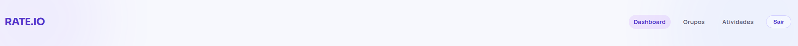

# Template Padrão da Aplicação

## CSS padrão

```
/******************************************
VARIÁVEIS DE COR, FONTE E ESTILO
******************************************/
:root {
  --canvas: #f7f8fd;
  --text: #5f5f74;
  --text-h: #14142b;
  --bg: #ffffff;
  --border: #e8e8f5;
  --code-bg: #f4f3ec;
  --accent: #aa3bff;
  --accent-bg: rgba(170, 59, 255, 0.1);
  --accent-border: rgba(170, 59, 255, 0.5);
  --accent-deep: #4f33c7;
  --shadow: rgba(0, 0, 0, 0.08) 0 20px 45px;

  --sans: system-ui, 'Segoe UI', Roboto, sans-serif;
  --heading: 'Sora', system-ui, sans-serif;
  --mono: ui-monospace, Consolas, monospace;
  --font-body: 'Manrope', sans-serif;
  --font-display: 'Sora', sans-serif;
  --font-editorial: 'Instrument Serif', serif;
  letter-spacing: 0.18px;
  color-scheme: light;
  color: var(--text);
  background: var(--canvas);
  font-synthesis: none;
  text-rendering: optimizeLegibility;
  -webkit-font-smoothing: antialiased;
  -moz-osx-font-smoothing: grayscale;
}
```
---
# Componentes

## Menu de navegação
Componente reutilizável definido em 'frontend/src/components/MenuNav.jsx'

Esse componente é dinâmico, e utilizando o contexto de autenticação definido em `../context/useAuth.jsx` ele pode mostrar na tela o menu de navegação para usuário logado com Dashboard, Grupos e Atividades ou então a opção de login para usuário não autenticado. Sua importação se faz através da função que o renderiza na tela: ```import MenuNav from '../components/MenuNav.jsx'```


---
## Protected Routes
Este componente de rotas protegidas verifica se o usuário está autenticado com suporte do contexto de autenticação e, se estiver, renderiza os filhos; caso contrário, redireciona para a página de login. Durante o bootstrapping (verificação inicial do token), a função pode exibir um indicador de carregamento com dizeres "Carregando Painel".. Disponível com ```import ProtectedRoute from '../components/ProtectedRoute.jsx'```
