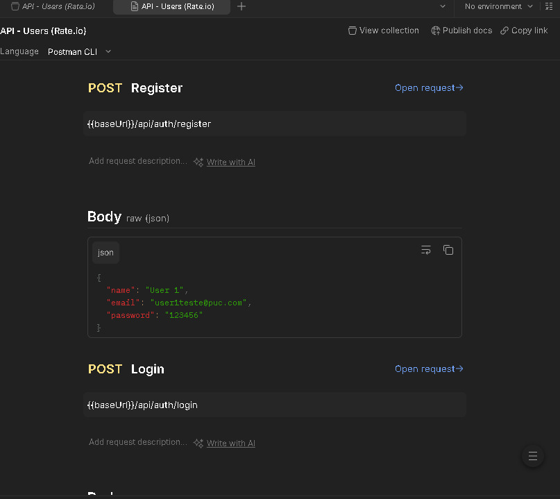
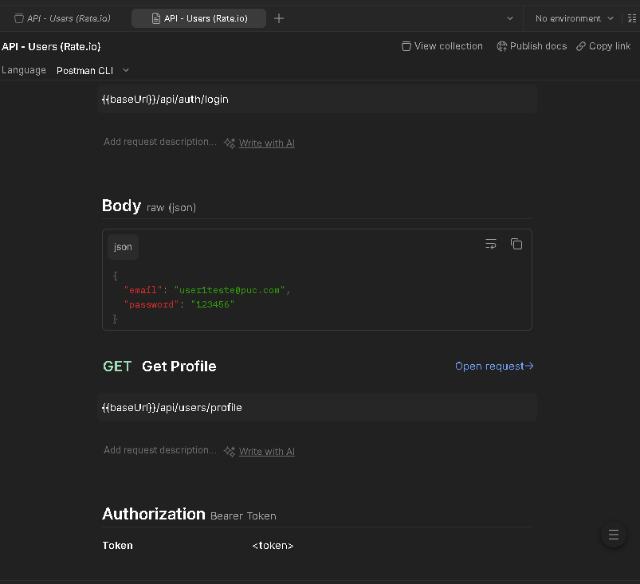
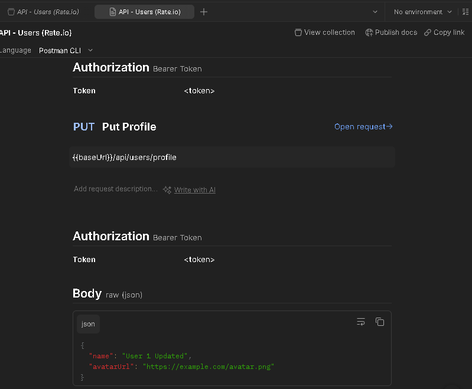
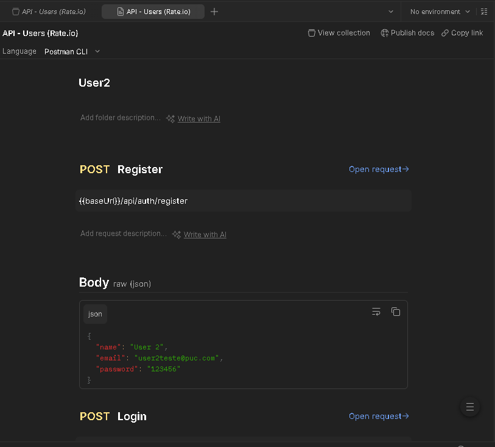

# 🚀 Documentação de Testes da API - Users (Rate.io)

Este diretório contém a documentação técnica e as evidências de testes dos endpoints de usuários, validados via Postman para a Etapa 2 do projeto.

## 1. Fluxo de Autenticação (Auth)

### Registro de Usuário (POST)
**Endpoint:** `{{baseUrl}}/api/auth/register`  
**Descrição:** Realiza o cadastro de novos usuários no sistema enviando `name`, `email` e `password`.

> **Evidência de Teste:**
> 

### Login de Usuário (POST)
**Endpoint:** `{{baseUrl}}/api/auth/login`  
**Descrição:** Valida as credenciais e retorna o Bearer Token necessário para acessar rotas protegidas.

> **Evidência de Teste:**
> 

---

## 2. Gerenciamento de Perfil (Users)

### Obter Perfil (GET)
**Endpoint:** `{{baseUrl}}/api/users/profile`  
**Requisito:** Requer Bearer Token no Header da requisição.

> **Evidência de Teste:**
> 

### Atualizar Perfil (PUT)
**Endpoint:** `{{baseUrl}}/api/users/profile`  
**Descrição:** Permite que o usuário logado altere suas informações de perfil (nome e avatar).

> **Evidência de Teste:**
> 

---

## 3. Artefatos Técnicos
- **Collection:** O arquivo JSON com todas as requisições configuradas está disponível nesta pasta para importação no Postman.
- **Ambiente:** Os testes foram realizados utilizando variáveis de ambiente para o `baseUrl`.

**Responsável:** Louise Dias  
**Data:** 07/04/2026