# Instruções de utilização

Crie pastas diferentes para o backend, frontend web e frontend mobile.

## Instalação do Site

O site em HTML/CSS/JS é um projeto estático, logo pode ser utilizado tanto em servidores...

## Histórico de versões

### [0.1.0] - DD/MM/AAAA

#### Adicionado

## Stack

- Node.js
- Express
- MongoDB (Mongoose)
- JWT para autenticacao
- Jest + Supertest para testes
- ESLint + Prettier para qualidade de codigo

## Dependências do Back-end

Dependências principais (instaladas via `npm install`):

- express
- cors
- mongoose
- bcryptjs
- jsonwebtoken
- dotenv

Dependências de desenvolvimento:

- nodemon
- jest
- supertest
- eslint
- prettier
- mongodb-memory-server

## Estrutura Principal

- `config/`: conexoes e configuracoes de banco
- `controllers/`: regras das rotas
- `middleware/`: autenticacao e protecoes
- `models/`: modelos MongoDB
- `routes/`: endpoints da API
- `services/`: regras de dominio (rateio/saldo)
- `tests/`: testes unitarios, integracao e sistema

## Scripts Uteis

```bash
npm run start
npm run dev
npm run lint
npm run lint:fix
npm run format
npm run test
npm run test:unit
npm run test:integration
npm run test:system
npm run test:auth
npm run test:expense
npm run test:group
npm run test:coverage
```

## Configurar ambiente do backend

```bash
cp src/backend/.env.example src/backend/.env
```

Preencha `src/backend/.env`:

```env
PORT=3000
JWT_SECRET=<sua-chave-jwt>
MONGO_URI_AUTH=<uri-do-mongo-auth>
MONGO_URI_USER=<uri-do-mongo-user>
MONGO_URI_EXPENSES=<uri-do-mongo-expenses>
MONGO_URI_GROUPS=<uri-do-mongo-groups>
```

Observações:

1. Faça URL encode da senha do Atlas, se necessário.
2. Libere seu IP em Network Access no Atlas.
3. Garanta permissão de leitura/escrita para o usuário do banco.

## Instalar dependências

```bash
cd src/backend
npm install
```

## Rodar a API

### Opção A: Docker (na raiz do projeto)

```bash
docker compose up --build
```

### Opção B: Node local (em `src/backend`)

```bash
npm run dev
```

## Verificar se a API subiu

```bash
curl http://localhost:3000/
curl http://localhost:3000/health
```


## Scripts úteis

```bash
npm run start
npm run dev
npm run lint
npm run lint:fix
npm run format
npm run test
npm run test:unit
npm run test:integration
npm run test:system
```

## Guia Reutilizável de Testes no Postman

### Criar Environment

Crie um Environment no Postman com:

1. `baseUrl` = `http://localhost:3000`
2. `tokenUser1`
3. `tokenUser2`
4. `profileIdUser1`
5. `profileIdUser2`
6. `groupId`
7. `expenseId`

### Regras importantes

1. Rotas protegidas exigem `Authorization: Bearer <token>`.
2. Para grupos e despesas, use IDs de perfil (não `authId`).
3. Body em `raw -> JSON`.
4. `update profile` usa `PUT`.
5. `settle` exige `userId` e `paidBy` no body.

### Endpoints principais (referência rápida)

Autenticação:

- `POST {{baseUrl}}/api/auth/register`
- `POST {{baseUrl}}/api/auth/login`

Usuário:

- `GET {{baseUrl}}/api/users/profile`
- `PUT {{baseUrl}}/api/users/profile`

Grupo:

- `POST {{baseUrl}}/api/groups`
- `POST {{baseUrl}}/api/groups/{{groupId}}/members`
- `GET {{baseUrl}}/api/groups/user/{{profileIdUser1}}`
- `GET {{baseUrl}}/api/groups/{{groupId}}/activities?userId={{profileIdUser1}}&limit=50`
- `DELETE {{baseUrl}}/api/groups/{{groupId}}`

Despesas:

- `POST {{baseUrl}}/api/expenses`
- `GET {{baseUrl}}/api/expenses/group/{{groupId}}?userId={{profileIdUser1}}`
- `POST {{baseUrl}}/api/expenses/{{expenseId}}/settle`
- `GET {{baseUrl}}/api/expenses/group/{{groupId}}/balances?userId={{profileIdUser1}}`

## Fluxo de requests

1. Registrar usuário 1 - **Endpoint**: `{{baseUrl}}/api/auth/register` - **Auth**: sem token
   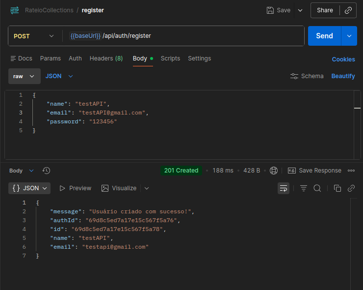

2. Login usuário 1 (salvar token em `tokenUser1`) - **Endpoint**: `{{baseUrl}}/api/auth/login` - **Auth**: sem token
   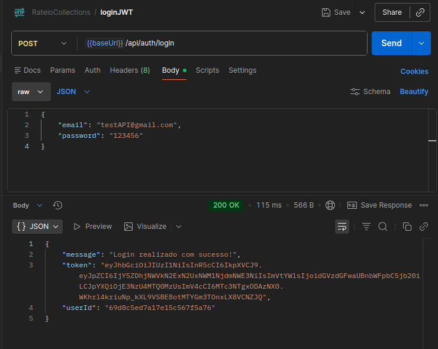

3. Registrar usuário 2 - **Endpoint**: `{{baseUrl}}/api/auth/login` - **Auth**: sem token
   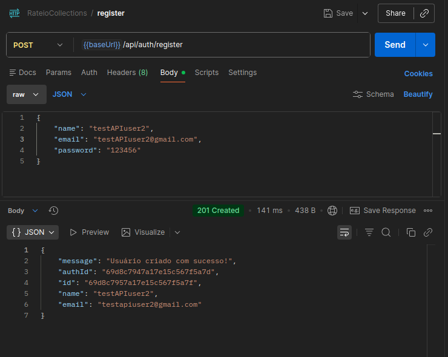

4. Login usuário 2 (salvar token em `tokenUser2`) - **Endpoint**: `` - **Auth**:
   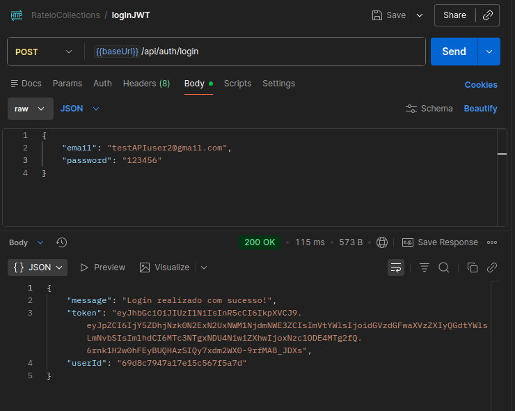

5. Buscar perfil do usuário 1 (salvar `_id` em `profileIdUser1`) - **Endpoint**: `{{baseUrl}}/api/users/profile` - **Auth**:`{{tokenUser1}}`
   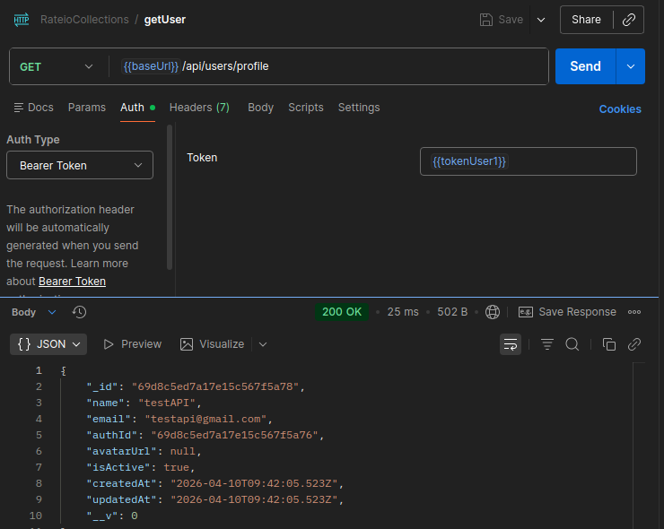

6. Buscar perfil do usuário 2 (salvar `_id` em `profileIdUser2`) - **Endpoint**: `{{baseUrl}}/api/users/profile` - **Auth**: `{{tokenUser2}}`
   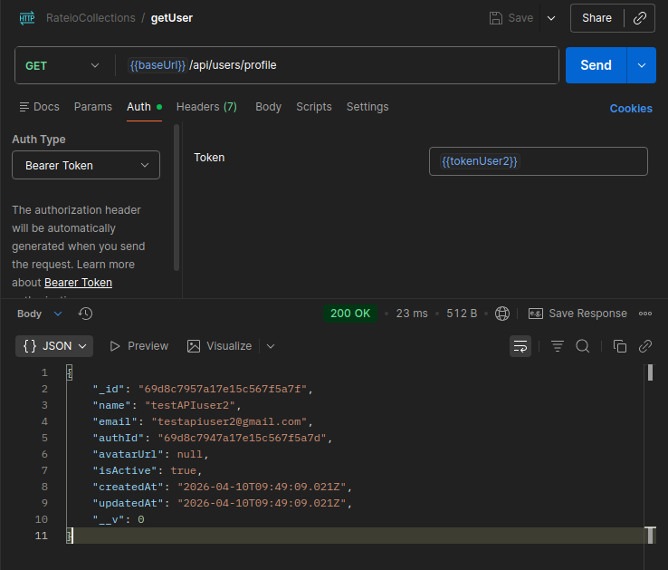

7. Criar grupo com usuário 1 (salvar `_id` em `groupId`) - **Endpoint**: `{{baseUrl}}/api/groups` - **Auth**:`{{tokenUser1}}`
   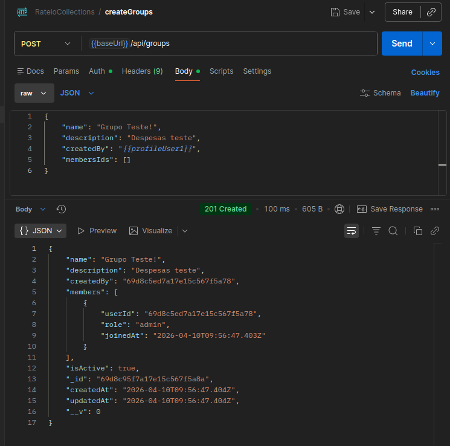

8. Adicionar usuário 2 no grupo - **Endpoint**: `{{baseUrl}}/api/groups/{{groupId}}/members` - **Auth**: `{{tokenUser1}}`
   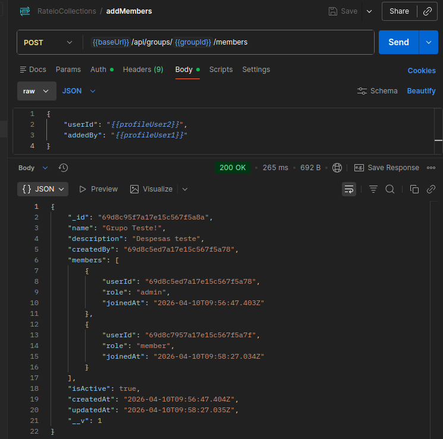

9. Listar grupos do usuário 1 - **Endpoint**: `{{baseUrl}}/api/groups/user/{{profileUser1}}` - **Auth**: `{{tokenUser1}}`
   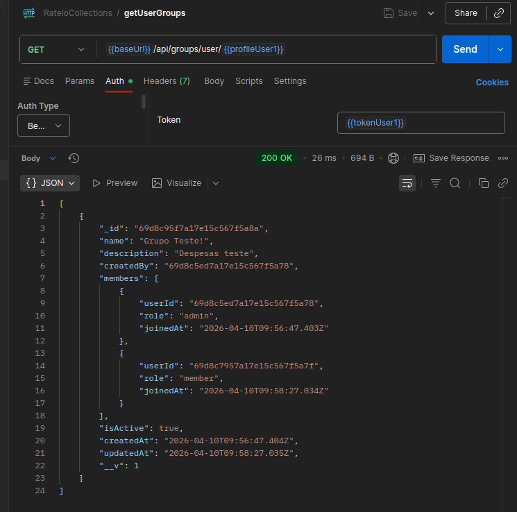

10. Criar despesa no grupo (salvar `expense._id` em `expenseId`) - **Endpoint**: `{{baseUrl}}/api/expenses` - **Auth**: `{{tokenUser1}}`
    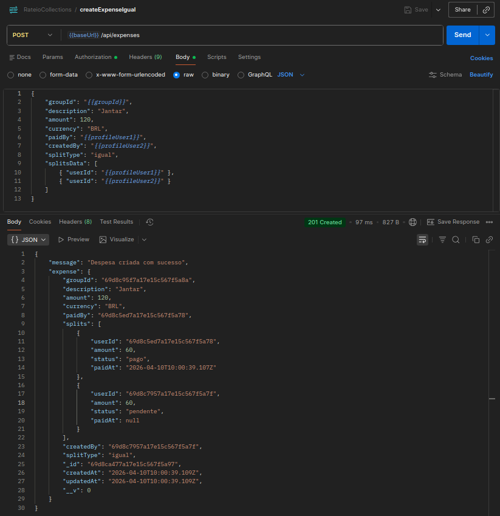

11. Listar despesas do grupo - **Endpoint**: `{{baseUrl}}/api/expenses/group/{{groupId}}?userId={{profileUser1}}` - **Auth**: `{{tokenUser1}}`
    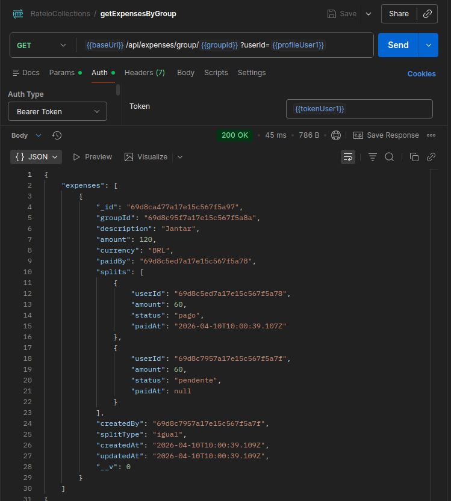

12. Marcar parcela como paga (`settle`) - **Endpoint**: `{{baseUrl}}/api/expenses/{{expenseId}}/settle` - **Auth**: `{{tokenUser2}}`
    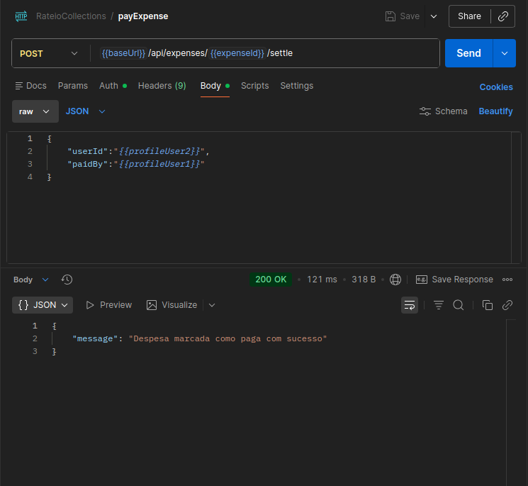

13. Consultar balanço do grupo - **Endpoint**: `{{baseUrl}}/api/expenses/group/{{groupId}}/balances?userId={{profileUser1}}` - **Auth**:`{{tokenUser1}}`
    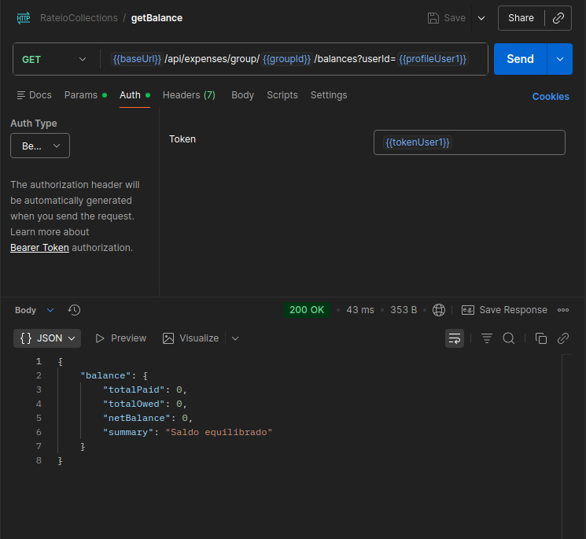

14. Listar atividades do grupo - **Endpoint**: `{{baseUrl}}/api/groups/{{groupId}}/activities?userId={{profileUser1}}&limit=50` - **Auth**:`{{tokenUser1}}`
    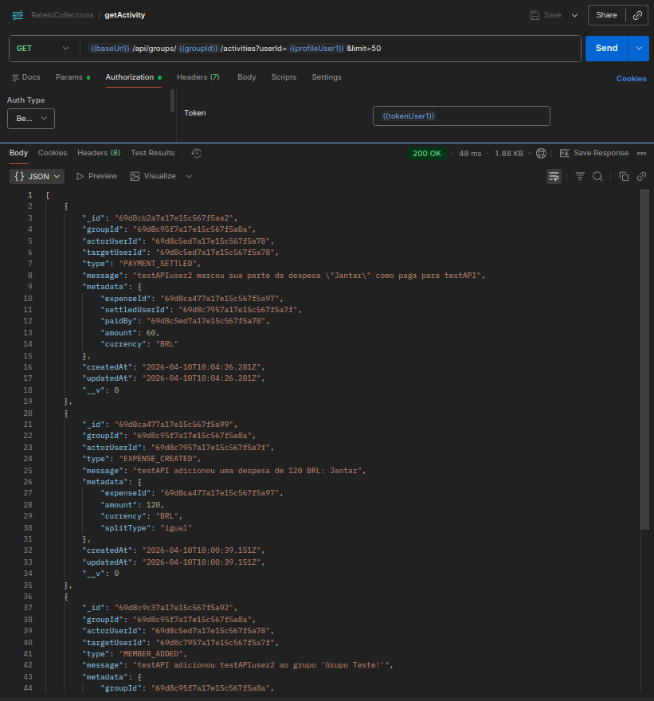

15. Deletar grupo - **Endpoint**: `{{baseUrl}}/api/groups/{{groupId}}` - **Auth**:`{{tokenUser1}}`
    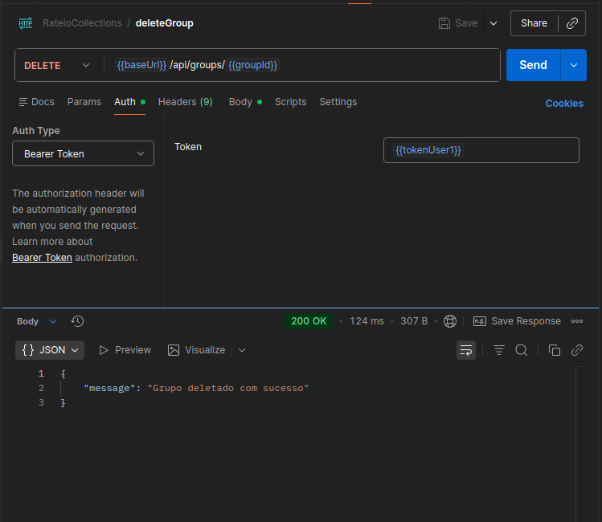

### Erros esperados (checklist)

1. Sem token em rota protegida -> `401`
2. Token inválido/expirado -> `401`
3. ObjectId inválido -> `400`
4. Usuário sem permissão -> `403`
5. Recurso inexistente -> `404`

## Troubleshooting rápido

### ENOENT package.json

Causa: comando executado fora de `src/backend`.

Correção:

```bash
cd src/backend
npm run dev
```

### Erro de autenticação MongoDB

Verifique:

1. Usuário e senha.
2. URL encode da senha.
3. Permissões no Atlas.
4. IP liberado em Network Access.

### Erro 401 no Postman

Verifique:

1. Bearer Token preenchido corretamente.
2. Token atualizado após novo login.

## Boas práticas

1. Não versionar `src/backend/.env`.
2. Versionar somente `src/backend/.env.example`.
3. Rodar `npm run format` e `npm run lint` antes de commit.
4. Usar branch por contexto (`feature/...`, `bugfix/...`, `docs/...`, `test/...`).

## Checklist de onboarding

1. Clonei o repositório.
2. Configurei `src/backend/.env`.
3. Instalei dependências.
4. Subi a API (Docker ou Node local).
5. Validei `GET /health`.
6. Rodei lint/format.
7. Testei fluxo principal no Postman.

---
